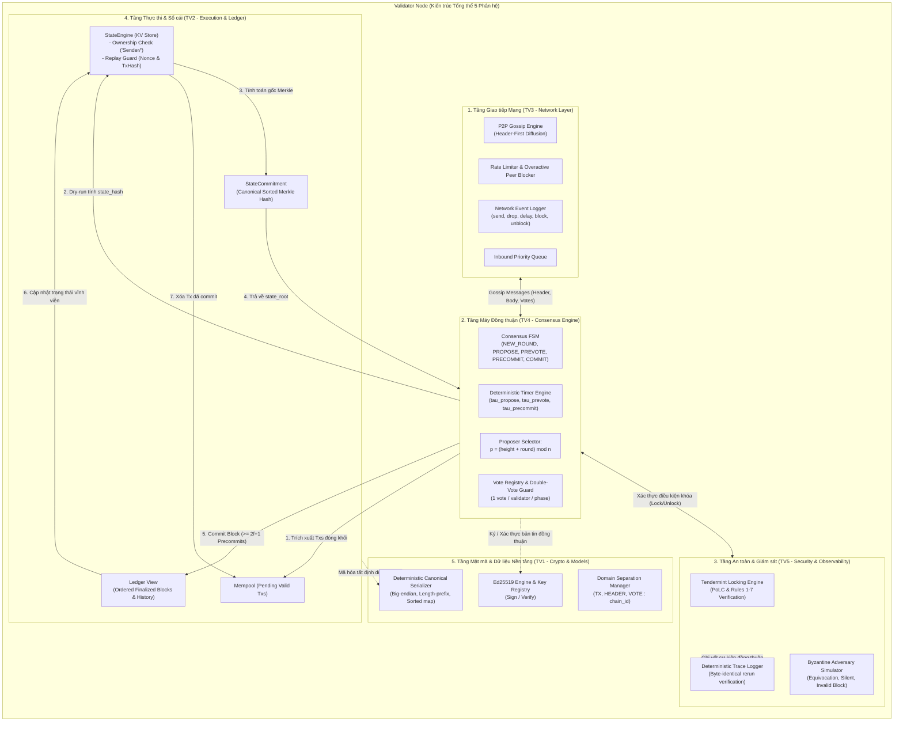
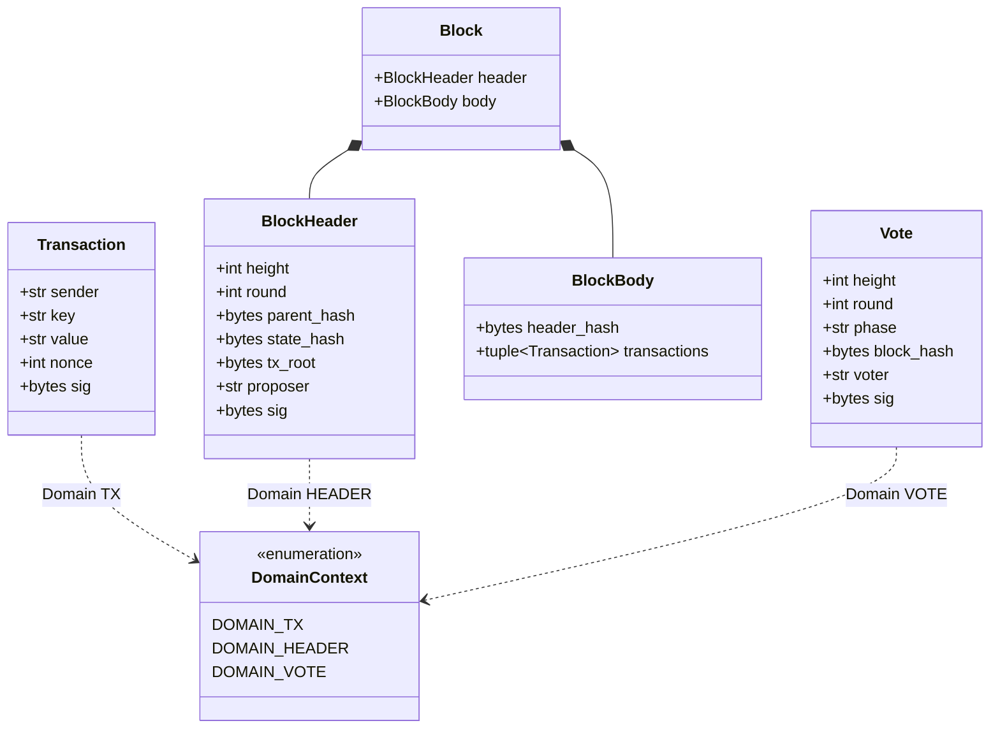
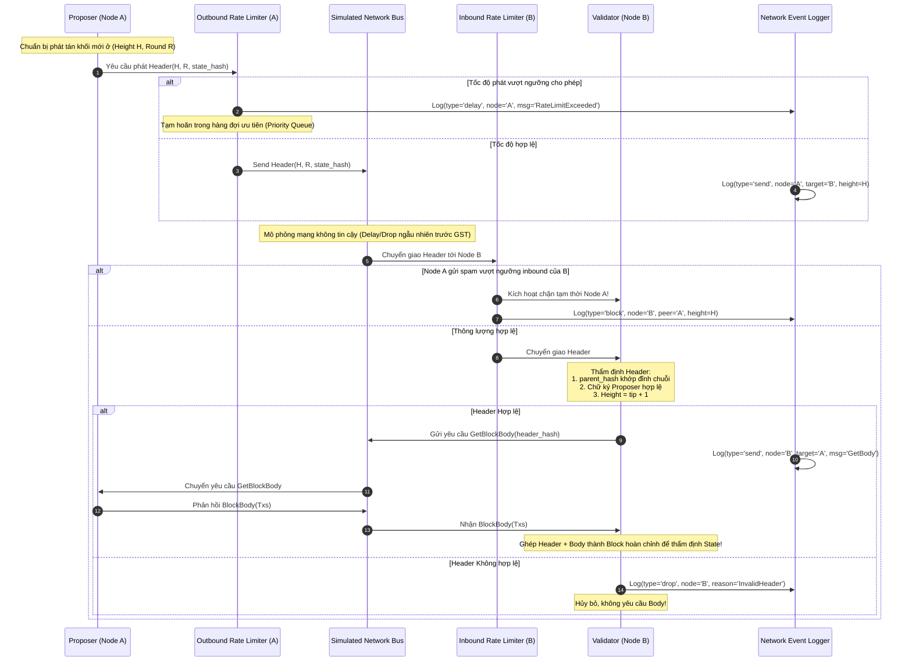
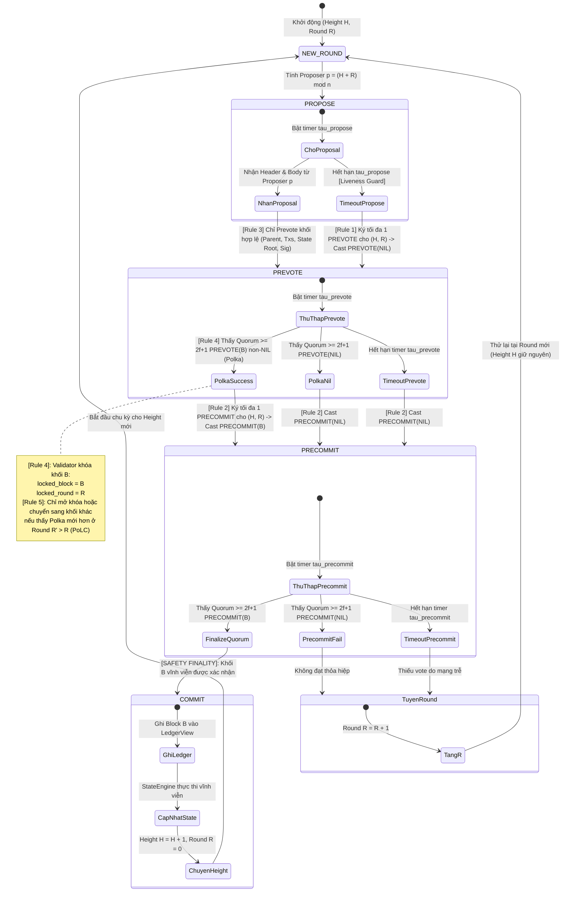
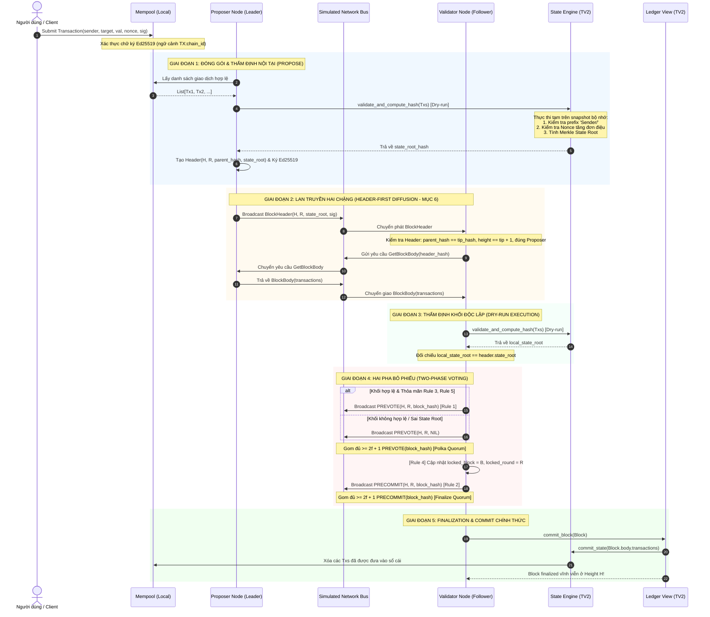
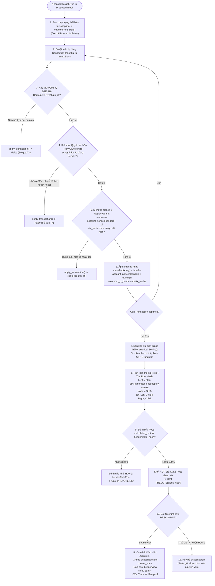
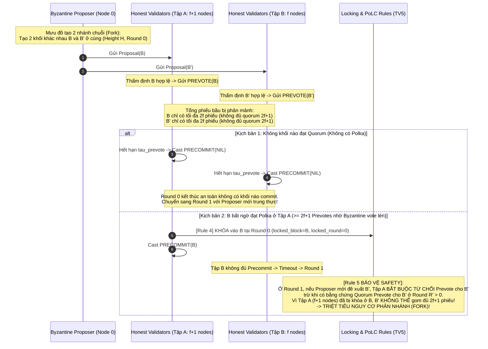
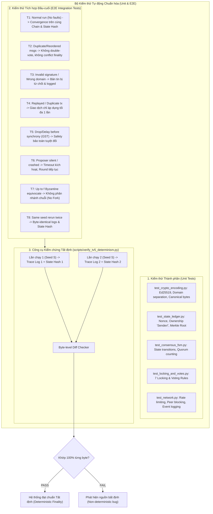

# TÀI LIỆU THIẾT KẾ HỆ THỐNG & TỔNG HỢP SƠ ĐỒ KỸ THUẬT (SYSTEM DESIGN)
## DỰ ÁN: MINIMAL LAYER 1 BLOCKCHAIN & BFT CONSENSUS SIMULATOR
### Học phần: Công nghệ Blockchain và Ứng dụng — HCMUS (Khóa 2026)
### Căn cứ đặc tả: Đề bài chính thức Lab 01 (`Lab01.pdf`)

---

## MỤC LỤC
1. [Tổng quan Kiến trúc Nút mạng Toàn diện (Node System Architecture)](#1-tổng-quan-kiến-trúc-nút-mạng-toàn-diện-node-system-architecture)
2. [Cấu trúc Dữ liệu, Mật mã & Domain Separation (Data Models & Cryptography Layer)](#2-cấu-trúc-dữ-liệu-mật-mã--domain-separation-data-models--cryptography-layer)
3. [Giao thức Truyền thông & Kiểm soát Tốc độ Mạng (Network Flow & Rate Limiting)](#3-giao-thức-truyền-thông--kiểm-soát-tốc-độ-mạng-network-flow--rate-limiting)
4. [Máy trạng thái Đồng thuận Tendermint BFT & 7 Quy tắc Khóa (Consensus FSM & 7 Rules)](#4-máy-trạng-thái-đồng-thuận-tendermint-bft--7-quy-tắc-khóa-consensus-fsm--7-rules)
5. [Vòng đời Khối Hoàn chỉnh: Hai chặng Header-First & Hai pha Bỏ phiếu (End-to-End Sequence)](#5-vòng-đời-khối-hoàn-chỉnh-hai-chặng-header-first--hai-pha-bỏ-phiếu-end-to-end-sequence)
6. [Tầng Thực thi & Cam kết Trạng thái Merkle (Execution Engine & State Commitment)](#6-tầng-thực-thi--cam-kết-trạng-thái-merkle-execution-engine--state-commitment)
7. [Mô hình Phòng chống Lỗi Byzantine & An toàn Đồng thuận (Fault Model & Byzantine Defense)](#7-mô-hình-phòng-chống-lỗi-byzantine--an-toàn-đồng-thuận-fault-model--byzantine-defense)
8. [Kiến trúc Kiểm thử Tất định T1 – T8 & Tái hiện Trạng thái (Deterministic Test Runner)](#8-kiến-trúc-kiểm-thử-tất-định-t1--t8--tái-hiện-trạng-thái-deterministic-test-runner)

---

## 1. Tổng quan Kiến trúc Nút mạng Toàn diện (Node System Architecture)

Hệ thống mô phỏng một mạng lưới Blockchain Layer 1 gồm $n$ validator cố định ($n \ge 8, n = 3f + 1$, cho phép tối đa $f$ nút Byzantine). Mỗi validator vận hành độc lập, không chia sẻ bộ nhớ, giao tiếp hoàn toàn thông qua mạng mô phỏng phi đồng bộ từng phần (*Partially Synchronous Network*).

---

## 2. Cấu trúc Dữ liệu, Mật mã & Domain Separation (Data Models & Cryptography Layer)

Theo **Mục 5 của Lab01.pdf**, mọi thông điệp ảnh hưởng đến trạng thái và đồng thuận đều phải được ký số Ed25519 với tiền tố ngữ cảnh (**Domain Separation**) tường minh để ngăn chặn triệt để tấn công Replay chéo giữa các tầng hoặc giữa các chain.

> **Quy tắc mã hóa nhị phân chuẩn hóa (Deterministic Encoding):**
> - **Số nguyên (`int`):** 8-byte Signed Big-Endian (`int.to_bytes(8, byteorder='big', signed=True)`).
> - **Chuỗi ký tự / Mảng byte (`str`, `bytes`):** Độ dài 4-byte Big-Endian tiền tố + payload bytes UTF-8.
> - **Từ điển (`dict`):** Sắp xếp tăng dần theo thứ tự byte chuẩn hóa của khóa trước khi tuần tự hóa.
> - **Khối dữ liệu / Đối tượng (`dataclass`):** Giữ nguyên thứ tự khai báo thuộc tính.

---

## 3. Giao thức Truyền thông & Kiểm soát Tốc độ Mạng (Network Flow & Rate Limiting)

Theo **Mục 6 của Lab01.pdf**, tầng mạng mô phỏng kênh truyền bất định (*unreliable*) với các ràng buộc khắt khe:
1. **Header broadcast trước Body:** Một Node chỉ gửi `BlockBody` khi nút nhận đã nhận và chấp nhận `BlockHeader` tương ứng.
2. **Kiểm soát tốc độ (Rate Limiting) & Chặn peer quá tải (Peer Blocking):** Mỗi node giới hạn lưu lượng phát ra và tạm thời block các peer vượt ngưỡng gửi bản tin.
3. **Nhật ký mạng đầy đủ:** Mọi sự kiện (`send`, `drop`, `delay`, `block`, `unblock`) đều phải được ghi log kèm timestamp, node ID, type và height.

---

## 4. Máy trạng thái Đồng thuận Tendermint BFT & 7 Quy tắc Khóa (Consensus FSM & 7 Rules)

Mục **6.1 của Lab01.pdf** đặt ra 7 quy tắc bắt buộc mà mọi validator trung thực phải tuân thủ để đảm bảo tính an toàn (**Safety**) và tính sống (**Liveness**). Sơ đồ dưới đây ánh xạ trực tiếp 7 quy tắc này vào các trạng thái FSM:

> **Ánh xạ 7 Quy tắc Khóa & Bỏ phiếu (Locking & Vote Rules - Mục 6.1):**
> 1. **Rule 1:** Chỉ ký tối đa 1 `PREVOTE` cho mỗi cặp `(height, round)`.
> 2. **Rule 2:** Chỉ ký tối đa 1 `PRECOMMIT` cho mỗi cặp `(height, round)`.
> 3. **Rule 3:** Chỉ chấp nhận và Prevote cho khối có parent hợp lệ, Txs hợp lệ, `state_hash` chính xác, đúng proposer và chữ ký chuẩn.
> 4. **Rule 4:** Khi quan sát thấy Quorum $\ge 2f + 1$ `PREVOTE(B)` non-NIL, validator **phải khóa** khối $B$ và ghi nhận `locked_round = round`.
> 5. **Rule 5 (PoLC):** Đã bị khóa ở khối $B$, chỉ được phép Prevote cho khối $B' \neq B$ nếu quan sát thấy một Quorum $\ge 2f + 1$ `PREVOTE(B')` ở một vòng đấu sau ($R' > \text{locked\_round}$).
> 6. **Rule 6:** Tuyệt đối không ký vote sai chain, sai height, sai round, sai phase hoặc sai domain.
> 7. **Rule 7:** Bỏ qua các vote trùng lặp, chỉ đếm tối đa 1 vote hợp lệ từ mỗi validator trên mỗi tọa độ `(height, round, phase)`.

---

## 5. Vòng đời Khối Hoàn chỉnh: Hai chặng Header-First & Hai pha Bỏ phiếu (End-to-End Sequence)

---

## 6. Tầng Thực thi & Cam kết Trạng thái Merkle (Execution Engine & State Commitment)

Mục **4 và Mục 7 của Lab01.pdf** quy định:
- Trạng thái là bảng bản ghi Khóa - Giá trị (`key-value`).
- Mỗi giao dịch chỉ được phép thay đổi phần dữ liệu thuộc quyền sở hữu của người gửi (`Sender/` prefix).
- Mọi node áp dụng cùng một danh sách giao dịch có thứ tự phải sinh ra kết quả trạng thái hoàn toàn giống nhau.
- Không có phí gas hay thực thi song song; mục tiêu trọng tâm là tính đúng đắn và tính đơn định tuyệt đối.

---

## 7. Mô hình Phòng chống Lỗi Byzantine & An toàn Đồng thuận (Fault Model & Byzantine Defense)

Theo **Mục 3 của Lab01.pdf**, hệ thống dung lỗi với tối đa $f$ validator Byzantine trong tổng số $n = 3f + 1$ nút:
- **Kẻ Byzantine có thể:** Im lặng (silent/crash), gửi bản tin trùng lặp (duplicate), gửi phiếu bầu mâu thuẫn (equivocation/double-voting), đề xuất khối sai (invalid block), phát lại bản tin cũ (replay).
- **Kẻ Byzantine không thể:** Giả mạo chữ ký của nút trung thực, tìm va chạm hàm băm SHA-256.

### Sơ đồ Cơ chế Chống Phân nhánh (Equivocation Defense via Tendermint Locking)

---

## 8. Kiến trúc Kiểm thử Tất định T1 – T8 & Tái hiện Trạng thái (Deterministic Test Runner)

Theo **Mục 8 và Mục 9 của Lab01.pdf**, hệ thống bắt buộc phải vượt qua bộ kiểm thử E2E gồm 8 kịch bản (T1 $\rightarrow$ T8) và phải chứng minh tính tất định tuyệt đối qua kịch bản chạy lại hai lần cùng một cấu hình hạt giống (`seed` ngẫu nhiên) sinh ra log mạng và mã băm trạng thái giống nhau từng byte (*Byte-identical output*).

---

## 9. Tổng hợp Ánh xạ Phân công Công việc và Báo cáo

| Phân hệ | Thành viên phụ trách | Mã nguồn chính | Đáp ứng yêu cầu Lab01.pdf | Sơ đồ minh họa |
| :--- | :--- | :--- | :--- | :--- |
| **TV1** | Thành viên 1 | `src/crypto/`, `src/common/serializer.py` | Mục 5: Ed25519, Domain separation (`TX`, `HEADER`, `VOTE`), Canonical Encoding | Sơ đồ 1, 2, 5 |
| **TV2** | Thành viên 2 | `src/execution/state.py`, `commitment.py`, `ledger.py` | Mục 4 & 7: State KV store, `Sender/` ownership, Nonce tracking, Merkle Root | Sơ đồ 1, 5, 6 |
| **TV3** | Thành viên 3 | `src/network/` | Mục 6: Header-first diffusion, Rate limiting, Peer blocking, Event logger | Sơ đồ 1, 3, 5 |
| **TV4** | Thành viên 4 | `src/consensus/` | Mục 2 & 6.1: Tendermint FSM, Quorum voting, Timeout engine, Proposer election | Sơ đồ 1, 4, 5 |
| **TV5** | Thành viên 5 | `src/security/`, `src/observability/` | Mục 3, 6.1, 8, 9: 7 Locking rules, Byzantine Equivocation, Replay audit T1-T8 | Sơ đồ 1, 4, 7, 8 |
