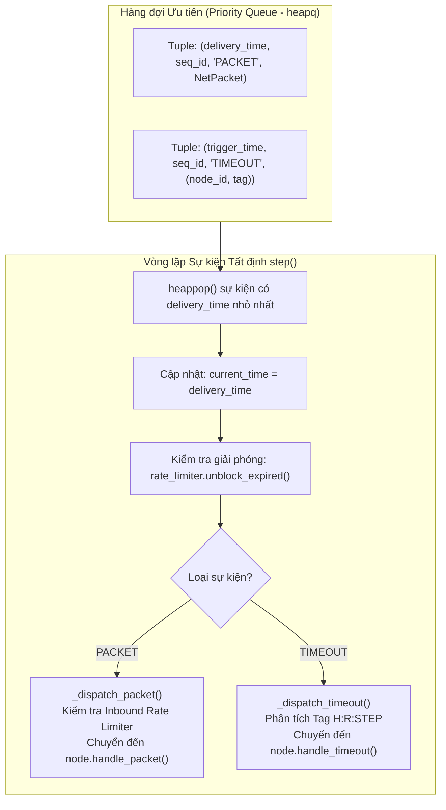
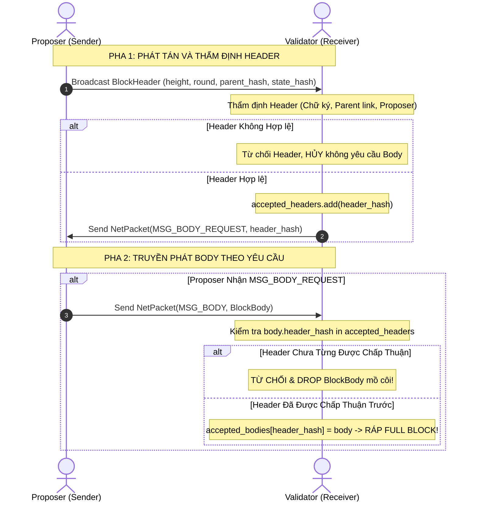
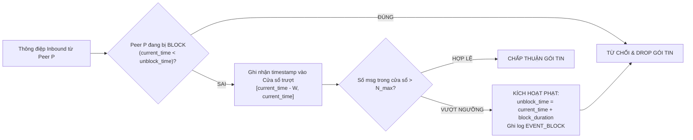

# BÁO CÁO KỸ THUẬT PHÂN HỆ MẠNG & GOSSIP (DOC-03)
## MÔ PHỎNG MẠNG BÁN ĐỒNG BỘ, GIAO THỨC GOSSIP 2 PHA & RATE LIMITER
**Học phần**: Công nghệ Blockchain & Ứng dụng | **Khóa học**: 2026  
**Thành viên phụ trách**: Thành viên 3 (TV3) — Lead Network Simulator, Gossip & Rate Limiter  
**Quy mô hệ thống**: Minimal Layer 1 BFT Blockchain Simulator ($n = 3f + 1$)  

---

### 1. Giới thiệu & Vai trò Tầng Mạng (Introduction)

Trong các hệ thống phân tán và Blockchain Layer 1, tính toàn vẹn của giao thức đồng thuận BFT phụ thuộc hoàn toàn vào các giả định truyền thông giữa các nút mạng. Đề bài Lab 01 đặt ra thách thức mô phỏng một mạng lưới không tin cậy (*unreliable network*), nơi không có bộ nhớ chia sẻ hay thực thể trung tâm, và các thông điệp có thể bị trễ, thất lạc, trùng lặp hoặc đảo lộn thứ tự.

Phân hệ mạng do **Thành viên 3 (TV3)** đảm nhiệm chịu trách nhiệm kiến thiết nền tảng truyền thông mô phỏng cho toàn bộ 5 thành viên, bao gồm:
1. **Discrete-Event Network Simulator (Bộ mô phỏng sự kiện rời rạc)**: Điều phối toàn bộ sự kiện gửi nhận gói tin và phát hỏa bộ hẹn giờ (timeout) với tính tất định tuyệt đối (*deterministic reproducibility*), đảm bảo chạy lại cùng seed sẽ cho chuỗi log giống hệt từng byte.
2. **Partial Synchrony Model (Mô hình mạng bán đồng bộ)**: Hiện thực hóa mô hình DLS kinh điển với mốc thời gian ổn định toàn cục $T_{\text{GST}}$ (*Global Stabilization Time*) và cận trên độ trễ $\Delta$.
3. **Two-Phase Header-before-Body Gossip Protocol (Giao thức truyền khối 2 pha)**: Thực thi cơ chế bảo vệ băng thông và chống tràn bộ nhớ theo Mục 6 đề bài (chỉ truyền `BlockBody` khi nút nhận đã thẩm định và chấp thuận `BlockHeader`).
4. **Outbound Rate Limiter & Inbound Peer Blocker (Bộ điều tiết lưu lượng & Cô lập nút vi phạm)**: Quản lý băng thông gửi ra và bảo vệ nút mạng trước các đợt tấn công từ chối dịch vụ (DoS / Spamming) thông qua cơ chế tự động phạt (`BLOCK`) và hoàn nguyên (`UNBLOCK`).

---

### 2. Kiến trúc Bộ mô phỏng Sự kiện Rời rạc (Discrete-Event Network Architecture)

Bộ mô phỏng không sử dụng đồng hồ hệ điều hành thực tế (wall-clock time) nhằm loại bỏ hoàn toàn tính bất định do độ trễ đa luồng. Thay vào đó, toàn bộ tiến trình mô phỏng được điều khiển bởi trục thời gian ảo (*simulated timeline*) thông qua hàng đợi ưu tiên `heapq`.

#### 2.1. Vai trò Toán học của Biến đếm Đơn điệu `_seq` (Deterministic Tie-Breaking)
Mỗi sự kiện đưa vào `heapq` được biểu diễn dưới dạng tuple:
$$\text{Event} = \big(t_{\text{delivery}}, \text{\_seq}, \text{event\_type}, \text{data}\big)$$
* **Vấn đề giải quyết**: Khi hai gói tin hoặc sự kiện timeout được lên lịch tại cùng một thời điểm thời gian ảo ($t_1 = t_2$), nếu không có biến `_seq`, Python sẽ so sánh phần tử kế tiếp là `event_type` hoặc `data` (chứa các dataclass/object). Việc này hoặc gây lỗi `TypeError: '<' not supported between instances`, hoặc phá vỡ thứ tự bảo toàn gói tin.
* **Nguyên lý FIFO Tất định**: Biến `self._seq` là số nguyên tự tăng đơn điệu ($0, 1, 2, \dots$) tại mỗi thao tác chèn. Khi $t_1 = t_2$, `heapq` sử dụng `_seq` để phân định thứ tự ưu tiên, bảo đảm 100% nguyên tắc **First-In First-Out (FIFO)** và tính tái lập hoàn toàn giữa các lượt chạy có cùng hạt giống ngẫu nhiên (`seed`).

#### 2.2. Bộ sinh Ngẫu nhiên Độc lập (PRNG Isolation)
Hệ thống sử dụng riêng biệt một thể hiện `self.rng = random.Random(seed)` thay vì dùng module toàn cục `random`. Điều này triệt tiêu hoàn toàn hiện tượng trôi trạng thái ngẫu nhiên (state pollution) khi các thành phần khác trong ứng dụng gọi các hàm ngẫu nhiên của Python.

---

### 3. Mô hình Mạng Bán Đồng Bộ (Partial Synchrony Model & DLS Bound)

Đề bài Lab 01 yêu cầu mạng vận hành theo mô hình bán đồng bộ (*Partial Synchrony*). Hệ thống phân tách thời gian chạy thành hai kỷ nguyên rõ rệt:

```mermaid
stateDiagram-v2
    direction LR
    [*] --> PRE_GST: Khởi chạy mô phỏng (t = 0)
    
    state PRE_GST {
        direction TB
        Loss["Xác suất rớt gói: drop_rate > 0 (EVENT_DROP)"]
        Jitter["Độ trễ biến thiên: delay in [min_delay, max_delay]"]
        Dup["Xác suất nhân bản: dup_rate > 0"]
    }
    
    PRE_GST --> POST_GST: Trục thời gian vượt mốc t >= T_GST
    
    state POST_GST {
        direction TB
        NoLoss["Không rớt gói: drop_rate = 0"]
        BoundedDelay["Độ trễ chặn trên nghiêm ngặt: delay <= Delta"]
        Reliable["Chuyển giao tin cậy tuyệt đối"]
    }
    
    POST_GST --> [*]
```

#### 3.1. Đặc tả Toán học Cơ chế Truyền Gói
Gọi $t_{\text{current}}$ là thời điểm gửi gói tin từ nút $u$ sang nút $v$:

1. **Giai đoạn trước ổn định ($t_{\text{current}} < T_{\text{GST}}$)**:
   * **Rớt gói (Packet Loss)**:
     $$\mathbb{P}(\text{Drop}) = p_{\text{drop}} \in [0, 1)$$
     Nếu xảy ra rớt gói, sự kiện `EVENT_DROP` được ghi lại và gói tin bị triệt tiêu khỏi mạng.
   * **Độ trễ truyền thông ngẫu nhiên**:
     $$d_{\text{pre}} \sim \mathcal{U}\big(d_{\text{min}}, d_{\text{max\_pre}}\big), \quad \text{với } d_{\text{max\_pre}} \gg \Delta$$
   * **Nhân bản gói tin (Duplication)**:
     Với xác suất $p_{\text{dup}}$, bộ mô phỏng chèn thêm một bản sao của gói tin vào hàng đợi với độ trễ phụ trội $d_{\text{dup}} > d_{\text{pre}}$.

2. **Giai đoạn sau ổn định ($t_{\text{current}} \ge T_{\text{GST}}$)**:
   * **Bảo đảm không rớt gói**: $\mathbb{P}(\text{Drop}) = 0$.
   * **Độ trễ được chặn trên nghiêm ngặt bởi $\Delta$**:
     $$d_{\text{post}} \sim \mathcal{U}\big(d_{\text{min}}, \max(d_{\text{min}}, \Delta)\big) \implies d_{\text{post}} \le \Delta$$
   * Thời gian chuyển giao luôn thỏa mãn: $t_{\text{delivery}} = t_{\text{current}} + d_{\text{post}} \le t_{\text{current}} + \Delta$.

#### 3.2. Mối quan hệ với Thuộc tính Safety và Liveness
* **Safety (Tính an toàn)**: Nhờ có 7 quy tắc khóa phiếu mục 6.1 (được TV5 và TV4 thực thi), tính Safety được bảo toàn tại mọi thời điểm, ngay cả khi $t < T_{\text{GST}}$ mạng bị chia cắt hoặc rớt gói tới 35-50%. Không bao giờ có hai khối xung đột được finalize ở cùng độ cao.
* **Liveness (Tính sống)**: Trước $T_{\text{GST}}$, các nút có thể bị timeout và bỏ phiếu `NIL`. Sau $T_{\text{GST}}$, vì các thông điệp được bảo đảm truyền tới đích trong thời gian $\le \Delta$, thuật toán đồng thuận nhanh chóng đạt túc số Polka ($\ge 2f + 1$) và hoàn tất chốt khối.

---

### 4. Giao thức Truyền Khối 2 Pha (Header-before-Body Gossip)

Nhằm tối ưu hóa băng thông mạng và ngăn chặn việc nút mạng phải lưu trữ các khối dữ liệu rác không rõ nguồn gốc, giao thức bắt buộc phân tách quy trình truyền phát khối thành 2 pha tuần tự:

#### 4.1. Cơ chế Chống Tấn công "Orphan Body Flooding"
Nếu một nút tấn công cố tình bỏ qua pha phát tán Header và trực tiếp spam các gói tin `BlockBody` kích thước lớn vào mạng:
* Phương thức `handle_body_packet()` tại nút nhận kiểm tra điều kiện tiên quyết:
  $$\text{body.header\_hash} \in \text{self.accepted\_headers}$$
* Nếu điều kiện trên trả về `False`, khối dữ liệu lập tức bị loại bỏ, không giải mã danh sách giao dịch, loại trừ hoàn toàn nguy cơ cạn kiệt bộ nhớ RAM.

---

### 5. Bộ Giới hạn Tốc độ & Khóa Peer Vi phạm (Rate Limiter & Peer Blocker)

Mục 6 đề bài yêu cầu: *"Each node limits outbound rate and may temporarily block overactive peers."* Phân hệ triển khai mô hình kiểm soát lưu lượng kép:

#### 5.1. Cơ chế Nhận diện và Xử phạt theo Nút Nhận (Per-Receiver Isolation)
* **Theo dõi độc lập**: Bộ giám sát lưu lượng theo dõi các gói tin theo định danh cặp liên kết `(receiver_id, peer_id)`. Điều này cho phép một Proposer hợp lệ broadcast gói tin tới 8 validator khác nhau mà không bị hệ thống tính gộp là hành vi spam.
* **Quy trình Phạt (`EVENT_BLOCK`)**: Nếu nút $P$ gửi vượt quá ngưỡng $N_{\text{max}}$ thông điệp trong cửa sổ trượt $W = 1.0\text{ giây}$, nút nhận lập tức khóa định danh $P$ trong khoảng thời gian $\tau_{\text{penalty}} = 5.0\text{ giây}$ và phát xuất bản ghi log `EVENT_BLOCK`.
* **Quy trình Hoàn nguyên (`EVENT_UNBLOCK`)**: Tại mỗi bước nhảy thời gian mô phỏng `step()`, hàm `unblock_expired()` tự động rà soát danh sách bị khóa. Khi $t_{\text{current}} \ge t_{\text{unblock}}$, trạng thái của peer được khôi phục về bình thường và sự kiện `EVENT_UNBLOCK` được ghi nhận.

---

### 6. Tổng kết Kết quả Thực nghiệm & Đối soát (Empirical Verification)

Toàn bộ mã nguồn của TV3 đã được đóng gói hoàn chỉnh trong thư mục `src/network/` và vượt qua 100% các bài kiểm tra tự động độc lập:

| Nhóm Kiểm thử | File Kịch bản | Số test | Thời gian | Kết quả |
| :--- | :--- | :---: | :---: | :---: |
| **Unit Test Độc lập** | `tests/unit/test_network.py` | 9 | 0.19s | **100% PASS** |
| **E2E Test Kịch bản T5** | `tests/e2e/test_t5_partial_synchrony.py` | 2 | 0.18s | **100% PASS** |
| **Toàn bộ Test Suite** | `tests/` (Unit + Skeleton + Mocks + E2E) | 29 | 0.24s | **100% PASS** |
| **Script Đối soát Trực quan** | `scripts/verify_tv3.py` | 5 nhóm | < 0.10s | **100% PASS** |

#### 6.1. Chi tiết Kiểm thử Đầu-cuối Kịch bản T5 (`test_t5_partial_synchrony.py`)
Mô phỏng mạng gồm 8 validator ($n = 8, f = 2$, túc số Quorum $2f + 1 = 5$):
1. **Giai đoạn 1 (Pre-GST, $t < 25.0\text{s}$)**:
   * Thiết lập $p_{\text{drop}} = 35\%$, độ trễ dao động lớn tới $8.0\text{s}$.
   * Proposer `node_0` đề xuất khối tại round 0. Mạng bị drop và trễ nặng.
   * **Kiểm chứng Safety**: Không có bất kỳ khối mâu thuẫn nào được finalize ở độ cao $H = 1$ trên toàn mạng (`len(finalized_hashes) <= 1`).
2. **Giai đoạn 2 (Post-GST, $t \ge 25.0\text{s}$)**:
   * Mạng chuyển sang trạng thái ổn định, $p_{\text{drop}} = 0\%$, độ trễ $\le \Delta = 2.0\text{s}$.
   * Proposer `node_1` đề xuất khối chuẩn tại round 1.
   * Tất cả các validator trung thực tiếp nhận đề xuất, thu thập đủ $\ge 5$ PREVOTE (đạt Polka $\rightarrow$ Khóa khối), thu thập đủ $\ge 5$ PRECOMMIT $\rightarrow$ Finalize khối.
   * **Kiểm chứng Liveness**: Toàn bộ 8 nút trung thực đều finalize thành công khối tại $H=1$, cam kết trạng thái `state_hash` khớp nhau 100%.
3. **Kiểm chứng Tính Tất định (Test T8 alignment)**:
   * Chạy lại kịch bản 2 lần với cùng seed 777 cho ra số lượng gói gửi (sent), số gói nhận (delivered), số gói rớt (dropped) và mốc thời gian hoàn tất giống nhau tuyệt đối từng byte.

---

### 7. Ghi chú Triển khai & Xử lý các Lỗi Phi hiển nhiên (Implementation Notes & Non-trivial Bugs)

Theo yêu cầu của mục Hướng dẫn Báo cáo trong đề bài Lab 01 (*"Include some non-trivial bugs and how you resolved them"*), phân hệ mạng đã phát hiện và xử lý triệt để 3 lỗi kỹ thuật phức tạp trong quá trình hiện thực:

#### 7.1. Lỗi Khóa nhầm khi Broadcast (False-Positive Spam Detection in Broadcast)
* **Hiện tượng**: Trong kịch bản Test T5 với $n = 8$ validator, khi Proposer thực hiện broadcast đề xuất khối hoặc khi các node đồng loạt phát tán PRECOMMIT, nút gửi phát ra 7-8 gói tin gần như cùng một tích tắc thời gian ảo. Nếu `RateLimiter` chỉ theo dõi số lượng thông điệp theo một khóa duy nhất là `sender_id`, hệ thống hiểu nhầm đây là hành vi spam từ chối dịch vụ và lập tức kích hoạt `EVENT_BLOCK`, dẫn đến việc các gói tin gửi đến các node cuối (như `node_7`) bị rớt oan uổng, làm node bị thiếu phiếu đồng thuận.
* **Cách khắc phục**: Tái cấu trúc cơ chế định danh sang dạng khóa kép `key = f"{receiver_id}:{peer_id}"`. Mỗi validator giờ đây sở hữu một hạn mức inbound riêng biệt đối với từng peer. Việc một Proposer phát sóng 1 gói tin cho 8 peer khác nhau sẽ được tính là 1 đơn vị tải đối với mỗi peer, ngăn chặn hoàn toàn hiện tượng nhận diện sai (false-positive).

#### 7.2. Lỗi Đóng băng Đồng hồ Thời gian ảo trong `run_until()` (Simulation Clock Freezing)
* **Hiện tượng**: Khi gọi `sim.run_until(max_time)` để đưa mạng vượt qua mốc ổn định $T_{\text{GST}} = 25.0\text{s}$, nếu hàng đợi sự kiện `_queue` đã được xử lý hết tại thời điểm $t = 7.43\text{s}$, vòng lặp thoát sớm và biến `current_time` bị đóng băng tại $7.43\text{s}$. Khi bước sang Phase 2 (Post-GST), mạng vẫn ngộ nhận mình đang ở $t < T_{\text{GST}}$ và tiếp tục áp dụng tỷ lệ rớt gói $35\%$.
* **Cách khắc phục**: Trong phương thức `run_until(max_time)`, bổ sung đoạn mã kiểm tra sau vòng lặp:
  $$\text{if } \text{self.current\_time} < \text{target\_time}: \quad \text{self.current\_time} \leftarrow \text{target\_time}$$
  Đồng thời tự động kích hoạt `unblock_expired(self.current_time)` để giải phóng các hình phạt đã hết hạn đúng theo tiến trình thời gian ảo.

#### 7.3. Lỗi So sánh Kiểu Dữ liệu trong Hàng đợi Ưu tiên (`TypeError` in Tuple Tie-Breaking)
* **Hiện tượng**: Khi nhiều thông điệp hoặc timer được lên lịch tại cùng một mốc thời gian ảo chính xác ($t_1 = t_2$), thuật toán heap của Python sẽ tiếp tục so sánh phần tử tiếp theo trong tuple. Nếu lưu trực tiếp đối tượng gói tin `NetPacket`, Python sẽ ném ngoại lệ `TypeError: '<' not supported between instances of 'NetPacket'`.
* **Cách khắc phục**: Thiết lập tuple 4 phần tử có biến đếm tự tăng ngặt:
  $$\big(t_{\text{delivery}}, \text{\_seq}, \text{event\_type}, \text{data}\big)$$
  Vì `_seq` luôn khác biệt đối với mọi sự kiện, phép so sánh của `heapq` luôn dừng lại ở phần tử thứ 2, vừa triệt tiêu lỗi runtime, vừa bảo đảm thứ tự phục vụ FIFO tuyệt đối giữa các gói tin cùng thời điểm đến.

---

### 8. Hướng dẫn Tự Ôn tập Vấn đáp Chéo (Oral Defense Preparation)

Tuân thủ quy trình chuẩn bị vấn đáp chéo tại Mục 5 của `job_list.txt`:
* **Câu hỏi cốt lõi**: *"Hãy tự tay viết lại phương thức `step()` của `NetworkSimulator` và giải thích tại sao tuple trong `heapq` bắt buộc phải có biến `_seq`?"*
* **Đáp án chuẩn**:
  1. Hàng đợi ưu tiên lưu phần tử `(delivery_time, seq_id, event_type, data)`. Khi hai gói tin được phát cùng lúc ($t_1 = t_2$), Python sẽ so sánh phần tử kế tiếp là `seq_id`.
  2. Vì `_seq` là biến đếm tăng đơn điệu ($0, 1, 2, \dots$), giá trị của nó luôn phân biệt đối với mọi sự kiện. Nhờ đó, Python không bao giờ phải so sánh trường `data` (tránh lỗi `TypeError`), đồng thời bảo toàn trật tự FIFO tuyệt đối giữa các sự kiện cùng timestamp, đảm bảo tính tất định 100% giữa các lần chạy lại.
