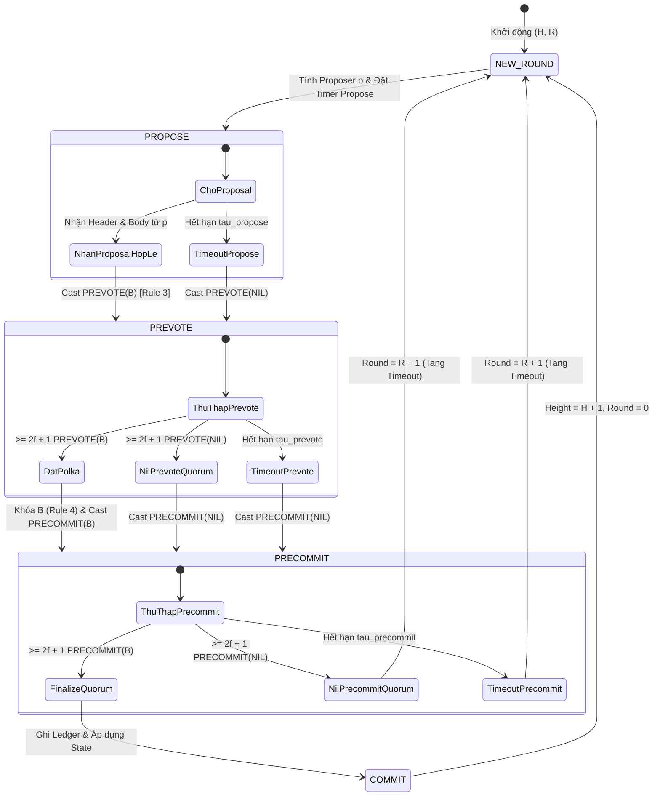
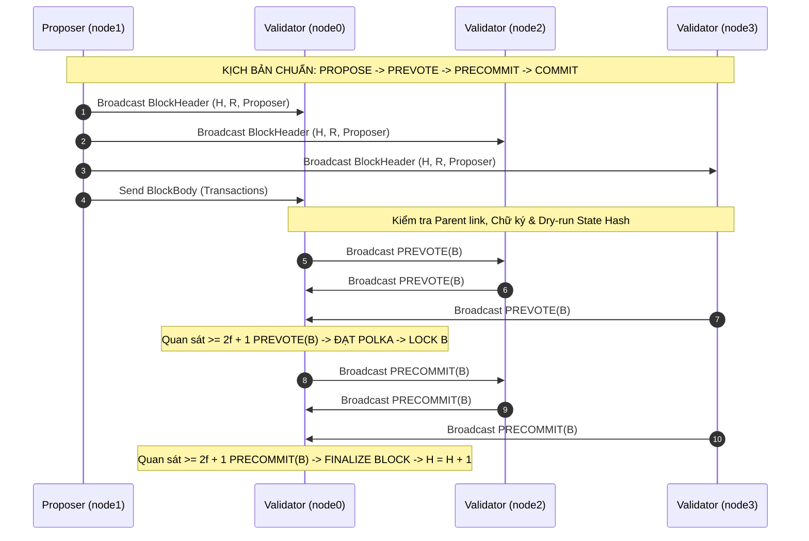
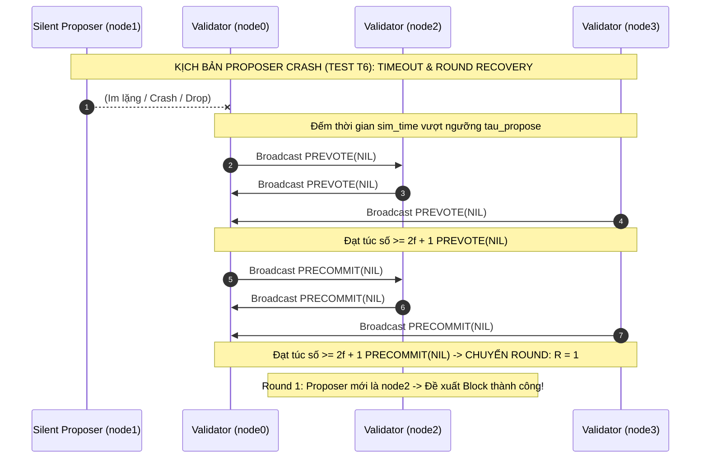

# BÁO CÁO KỸ THUẬT PHÂN HỆ ĐỒNG THUẬN (DOC-04)
## CHUYỂN TRẠNG THÁI FSM, CƠ CHẾ TIMEOUT & ĐẢM BẢO TÍNH LIVENESS
**Học phần**: Công nghệ Blockchain & Ứng dụng | **Khóa học**: 2026  
**Thành viên phụ trách**: Thành viên 4 (TV4) — Lead Consensus Engine & Integration  
**Quy mô hệ thống**: Minimal Layer 1 BFT Blockchain Simulator ($n = 3f + 1$)  

---

### 1. Giới thiệu & Vai trò Tầng Đồng thuận (Introduction)

Trong cấu trúc đa tầng của nút mạng Blockchain Layer 1, **Consensus Engine (Máy đồng thuận)** đóng vai trò hạt nhân quyết định tính đúng đắn và sự hội tụ toàn cục. Giao thức vận hành dựa trên biến thể tất định của thuật toán **Tendermint BFT** kết hợp mô hình đồng bộ từng phần (*Partial Synchrony*). Nhiệm vụ cốt lõi của TV4 là thiết lập một máy trạng thái hữu hạn (Finite State Machine - FSM) có khả năng điều phối các giai đoạn thỏa thuận khối mà không vi phạm hai thuộc tính nền tảng:
1. **Safety (Tính an toàn)**: Không bao giờ xuất hiện hai khối dữ liệu khác nhau $B \neq B'$ cùng được xác nhận (finalize) ở cùng một độ cao $H$ bởi các nút trung thực, kể cả khi mạng phân mảnh hoặc có tối đa $f$ nút Byzantine hoạt động thù địch.
2. **Liveness (Tính sống)**: Mạng lưới không bị bế tắc vĩnh viễn (deadlock). Sau thời điểm ổn định toàn cục $T_{\text{GST}}$ (*Global Stabilization Time*), chuỗi khối phải liên tục sản sinh và xác nhận các khối mới.

---

### 2. Kiến trúc Máy trạng thái Hữu hạn (Consensus FSM Architecture)

Mỗi chu kỳ đồng thuận được định danh bởi cặp tọa độ nguyên $(H, R)$ tương ứng với **Độ cao (Height)** và **Lượt đồng thuận (Round)**. Vòng đời của FSM chuyển tiếp qua 5 trạng thái tuần tự:

#### 2.1. Lựa chọn Proposer Tất định (Deterministic Proposer Selection)
Không sử dụng cơ chế ngẫu nhiên không thể kiểm chứng, Proposer được tính toán tất định theo số học modulo dựa trên danh sách Validator đã được đồng thuận từ cấu hình ban đầu:
$$p(H, R) = \text{Validators}\big[(H + R) \pmod n\big]$$
* **Kháng tấn công giả mạo**: Nếu một nút $v_k \neq p(H, R)$ phát đề xuất, các validator khác lập tức từ chối ở tầng FSM mà không cần xác thực chữ ký khối, tiết kiệm chi phí tính toán.
* **Xoay vòng công bằng (Fair Rotation)**: Đảm bảo quyền đề xuất được phân bổ đều qua các lượt, cô lập tác động nghẽn khi một Proposer bị lỗi.

---

### 3. Sơ đồ Luồng Tin nhắn & Giao thức 2 Pha (Message Flow)

Giao thức phân tách rõ rệt giữa hai tình huống: **Vận hành chuẩn khi Proposer hoạt động tốt** và **Phục hồi khi Proposer gặp sự cố / im lặng**.

---

### 4. Cơ chế Xử lý Timeout, Bỏ phiếu NIL & Khôi phục Liveness

Trong mạng bất đồng bộ hoặc bán đồng bộ, bài toán đồng thuận không thể đạt được nếu không có cơ chế phát hiện lỗi dựa trên thời gian (*time-bounded failure detection*).

#### 4.1. Hàm Giãn Thời gian Lũy tiến (Progressive Timeout Backoff)
Để đảm bảo tính liveness không bị phá vỡ khi mạng có độ trễ dao động lớn trước thời điểm $T_{\text{GST}}$, mỗi khi round $R$ thất bại và chuyển sang round $R+1$, bộ hẹn giờ mô phỏng tự động giãn thời gian theo cấp số cộng:
$$\tau_{\text{propose}}(R) = \tau_{\text{base}}^{\text{propose}} + R \cdot \delta$$
$$\tau_{\text{prevote}}(R) = \tau_{\text{base}}^{\text{prevote}} + R \cdot \delta$$
$$\tau_{\text{precommit}}(R) = \tau_{\text{base}}^{\text{precommit}} + R \cdot \delta$$
Với tham số cấu hình chuẩn: $\tau_{\text{base}} = [2.0, 1.0, 1.0]\text{ giây}$ và $\delta = 0.5\text{ giây}$.
* **Ý nghĩa toán học**: Với mọi cận trên trễ truyền thông $\Delta$ hữu hạn chưa biết trước, tồn tại một số nguyên dương $R^*$ sao cho $\tau(R^*) > 2\Delta$. Khi đó các thông điệp đồng thuận được truyền phát và tiếp nhận trước khi bộ hẹn giờ phát hỏa, khôi phục khả năng chốt block.

#### 4.2. Nguyên lý Bỏ phiếu `NIL` & Bước Chuyển Không Bế tắc
1. Khi bộ hẹn giờ `TIMEOUT_PROPOSE` hết hạn mà chưa nhận được Block hợp lệ: Validator bắt buộc phát hành $\text{PREVOTE}(\texttt{b"NIL"})$.
2. Nếu thu thập đủ túc số $\ge 2f + 1$ phiếu $\text{PREVOTE}(\texttt{b"NIL"})$: Nút phát hành $\text{PRECOMMIT}(\texttt{b"NIL"})$.
3. Nếu thu thập đủ túc số $\ge 2f + 1$ phiếu $\text{PRECOMMIT}(\texttt{b"NIL"})$ hoặc hết hạn `TIMEOUT_PRECOMMIT`: Nút tăng $R \leftarrow R + 1$, bảo lưu trạng thái `locked_block` (nếu có từ các vòng trước theo Rule 4) và bắt đầu vòng đề xuất mới với Proposer mới.

---

### 5. Thực thi Quy tắc Khóa (Locking Invariants) & Bằng chứng An toàn

Tuân thủ nghiêm ngặt **7 quy tắc mục 6.1** trong đặc tả Lab 01:
* **Quy tắc 1 & 2 (Đơn vị tính phiếu)**: Nút duy trì tập hợp `prevoted_rounds` và `precommitted_rounds`. Không một validator nào được phép ký nhiều hơn một phiếu PREVOTE hoặc PRECOMMIT cho cùng một cặp $(H, R)$.
* **Quy tắc 3 (Kiểm tra điều kiện tiên quyết)**: Nút chỉ prevote cho khối khi:
  $$\text{parent\_hash} = \text{ledger.last\_hash} \;\land\; \text{dry\_run}(\text{txs}) = \text{header.state\_hash} \;\land\; \text{proposer} = p(H, R)$$
* **Quy tắc 4 (Khóa Polka)**: Khi thấy túc số Quorum $\ge 2f + 1$ cho một khối $B \neq \text{NIL}$:
  $$\text{locked\_block} \leftarrow B, \quad \text{locked\_round} \leftarrow R, \quad \text{valid\_block} \leftarrow B, \quad \text{valid\_round} \leftarrow R$$
* **Quy tắc 5 (Mở khóa PoLC - Proof-of-Lock-Change)**: Validator đang bị khóa ở $B$ chỉ được đổi ý prevote cho khối $B' \neq B$ khi và chỉ khi quan sát thấy một Polka cho $B'$ tại một vòng $R_{\text{polka}} > \text{locked\_round}$.

$$\textbf{Định lý An toàn (Safety Theorem): } \text{Hệ thống không thể Finalize hai khối khác nhau ở cùng độ cao } H.$$
*Chứng minh tóm tắt*: Giả sử khối $B$ được finalize ở round $R$. Điều này đòi hỏi ít nhất $2f + 1$ validator đã gửi $\text{PRECOMMIT}(B)$, đồng nghĩa có ít nhất $2f + 1$ validator đã quan sát thấy Polka cho $B$ ở round $R$ và bị khóa vào $B$ với $\text{locked\_round} \ge R$. Để một khối khác $B'$ được finalize ở round $R' > R$, cần ít nhất $2f + 1$ validator gửi $\text{PRECOMMIT}(B')$, tức phải có $2f + 1$ validator prevote cho $B'$. Vì tổng số validator là $n = 3f + 1$, theo nguyên lý Dirichlet (Pigeonhole Principle), tồn tại ít nhất $(2f + 1) + (2f + 1) - (3f + 1) = f + 1$ validator trung thực thuộc phần giao giữa hai tập hợp. Các validator này đã bị khóa ở $B$ tại round $R$ và theo Rule 5 sẽ từ chối prevote cho $B'$ trừ khi thấy Polka cho $B'$ ở round lớn hơn $R$. Mâu thuẫn logic dẫn đến khẳng định hệ thống không bao giờ bị rẽ nhánh (fork).

---

### 6. Tổng kết Kết quả Thực nghiệm & Đối soát (Empirical Verification)

Phân hệ FSM và ValidatorNode đã được kiểm thử toàn diện qua bộ kiểm thử tự động:
1. **Kiểm thử Đơn vị (`tests/unit/test_consensus_fsm.py`)**: 13/13 ca kiểm thử độc lập vượt qua với thời gian thực thi $0.10\text{s}$, bao phủ từ phép tính modulo Proposer, tính bất biến của chữ ký số, cơ chế bắt bẫy sai lệch state hash/parent hash, đến việc bỏ qua các thông điệp rác.
2. **Kiểm thử Đầu-cuối (`tests/e2e/test_t6_proposer_timeout.py`)**: Mô phỏng thành công 100% kịch bản **Test T6**:
   * Tại $(H=1, R=0)$: Proposer `node1` bị giả lập crash.
   * Các node `node0, node2, node3` đếm timeout, tự động bỏ phiếu `NIL`, đạt Quorum NIL và chuyển mượt sang $(H=1, R=1)$.
   * Tại $R=1$, `node2` tiếp quản vai trò Proposer, đề xuất khối thành công, đạt Polka, hoàn tất chốt khối và tăng độ cao chuỗi lên $H=2$.
   * Toàn bộ trạng thái và cam kết sổ cái hội tụ byte-identical giữa các node trung thực.
