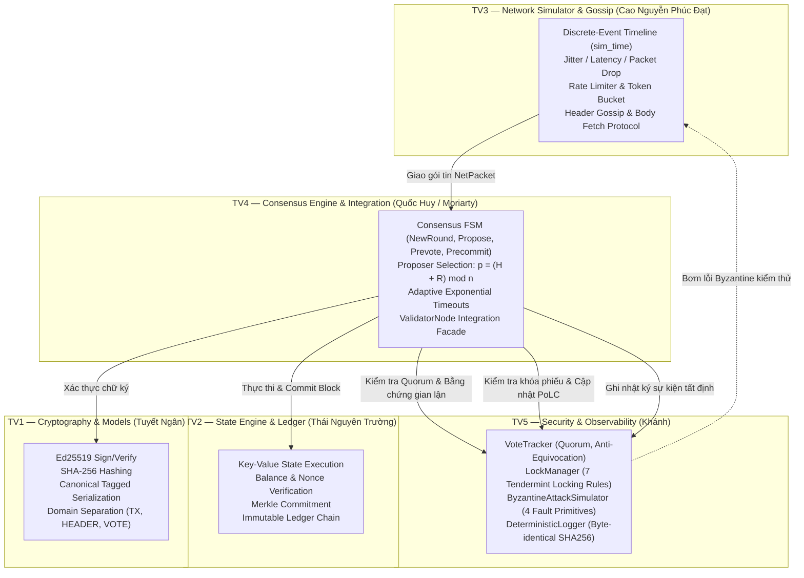
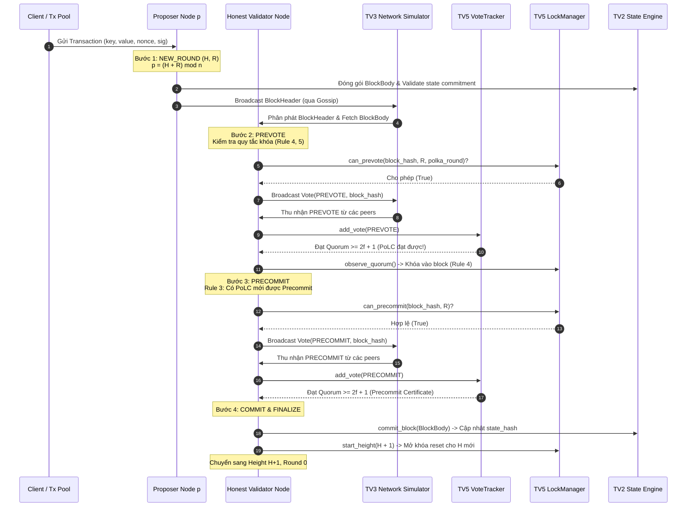
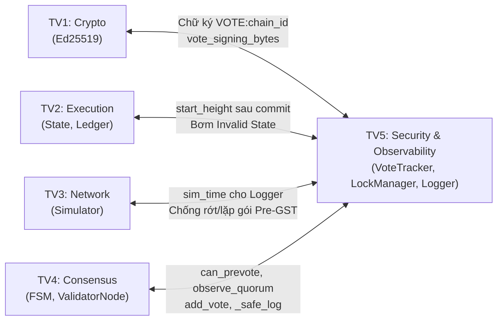

# BÁO CÁO REVIEW VÀ BIÊN BẢN BÀN GIAO KỸ THUẬT PHÂN HỆ TV5
## (TV5 TECHNICAL HANDOVER & TRANSFERRING MEETING NOTES)

* **Học phần**: Công nghệ Blockchain & Ứng dụng — HCMUS
* **Đồ án**: Minimal Layer 1 Blockchain & BFT Consensus Simulator (Lab 01)
* **Thành viên phụ trách**: Khánh (TV5) — MSSV: `23120282`
* **Email**: `23120282@student.hcmus.edu.vn`
* **Phân hệ đảm nhiệm**: **TV5 — Consensus Locking Rules, Byzantine Fault Simulator, Deterministic Structured Event Logging, & Testing Evidence (T1–T8)**
* **Nhánh phát triển**: `feature/tv5-locking-byzantine` (đã merge vào `main` qua PR #3 và tích hợp hoàn chỉnh tại PR #6)
* **Trạng thái hiện tại**: **Hoàn thành 100%** (Vượt qua 85/85 tests trong toàn bộ test suite dự án)

---

## 1. KNOWLEDGE TRANSFER: BỐI CẢNH DỰ ÁN & KIẾN THỨC TOÀN CỤC (SYSTEM-WIDE CONTEXT)

Phần này cung cấp bức tranh kiến trúc tổng thể của toàn dự án Blockchain Lab 01, giúp các thành viên trong nhóm và người tiếp nhận nắm rõ bối cảnh kỹ thuật, cơ chế vận hành và vai trò tương hỗ giữa 5 phân hệ trước khi đi sâu vào chi tiết phân hệ TV5.

### 1.1. Mục tiêu và Bài toán Hệ thống
Hệ thống là một **Trình mô phỏng Chuỗi khối Layer 1 tối thiểu (Minimal Layer 1 Blockchain Simulator)**, vận hành dựa trên biến thể tất định của giao thức đồng thuận **Tendermint BFT**.

Hệ thống được thiết kế để giải quyết bài toán đồng thuận trạng thái phân tán giữa $n$ nút mạng (Validator Nodes) trong môi trường mạng không tin cậy:
* **Mô hình mạng Đồng bộ từng phần (Partial Synchrony — DLS Model)**:
  * **Giai đoạn trước ổn định ($t < T_{\text{GST}}$)**: Mạng hoạt động bất đồng bộ, có thể xảy ra phân mảnh mạng (network partition), trễ đường truyền lớn, mất gói tin (drop rate đến 25–50%), lặp gói (duplicate) hoặc xáo trộn thứ tự gói tin (reorder).
  * **Thời điểm ổn định toàn cục ($T_{\text{GST}}$ — Global Stabilization Time)**: Là mốc thời gian mà sau đó mạng chuyển sang trạng thái đồng bộ, mọi thông điệp gửi đi đều được phân phát đến đích trong khoảng thời gian có cận trên $\Delta$.
* **Hai thuộc tính nền tảng bắt buộc phải thỏa mãn**:
  1. **Safety (Tính an toàn)**: Không bao giờ có hai khối xung đột $B \neq B'$ cùng được xác nhận (finalize) ở cùng một độ cao $H$ bởi bất kỳ hai nút trung thực nào, kể cả trong giai đoạn bất đồng bộ trước $T_{\text{GST}}$ hoặc khi có sự hiện diện của tối đa $f$ nút tấn công Byzantine.
  2. **Liveness (Tính sống)**: Mạng không bị bế tắc vĩnh viễn (deadlock). Sau $T_{\text{GST}}$, chuỗi khối phải liên tục sản sinh và xác nhận các khối mới.
* **Ngưỡng dung sai lỗi Byzantine**:
  Tổng số nút validator $n \ge 3f + 1$, cho phép hệ thống chịu được tối đa $f = \lfloor (n - 1) / 3 \rfloor$ nút gặp lỗi hoặc cố tình phá hoại (Byzantine nodes). Ngưỡng đạt đồng thuận (Quorum) bắt buộc là $2f + 1$.

---

### 1.2. Bản đồ 5 Phân hệ (TV1 đến TV5) và Phân công Trách nhiệm

Dự án được chia thành 5 phân hệ chuyên trách độc lập, giao tiếp với nhau chặt chẽ qua các hợp đồng giao diện chuẩn (Typing Protocols định nghĩa tại `src/common/interfaces.py`):



| Phân hệ | Thành viên phụ trách | Trách nhiệm cốt lõi | Các module & files chính |
| :--- | :--- | :--- | :--- |
| **TV1** | Tuyết Ngân | Mật mã học, băm dữ liệu, tuần tự hóa chuẩn hóa tất định và phân tách miền chữ ký | `src/crypto/ed25519.py`<br/>`src/crypto/keys.py`<br/>`src/common/serializer.py` |
| **TV2** | Thái Nguyên Trường | Máy thực thi trạng thái KV, kiểm tra nonce/sở hữu tài khoản, tính cam kết Merkle và sổ cái lưu trữ | `src/execution/state.py`<br/>`src/execution/ledger.py`<br/>`src/execution/commitment.py` |
| **TV3** | Cao Nguyễn Phúc Đạt | Trình mô phỏng mạng sự kiện rời rạc, giới hạn lưu lượng, lan truyền Header và đồng bộ Body | `src/network/simulator.py`<br/>`src/network/gossip.py`<br/>`src/network/rate_limiter.py` |
| **TV4** | Phan Hoàng Quốc Huy | Máy trạng thái đồng thuận FSM, chọn Proposer, bộ đếm timeout thích ứng và điều phối ValidatorNode | `src/consensus/fsm.py`<br/>`src/consensus/node.py`<br/>`src/consensus/proposer.py` |
| **TV5** | **Khánh (23120282)** | **7 quy tắc khóa phiếu, bắt gian lận Equivocation, mô phỏng tấn công Byzantine và ghi log tất định** | `src/security/locking.py`<br/>`src/security/byzantine.py`<br/>`src/observability/logger.py` |

---

### 1.3. Chu trình Đồng thuận và Vòng đời của một Khối (Consensus Loop & Block Lifecycle)

Mỗi độ cao chuỗi $H$ bắt đầu từ round $R = 0$. Một vòng đồng thuận hoàn chỉnh trải qua 5 bước chuyển trạng thái tuần tự:



---

### 1.4. Vị thế và Vai trò của Phân hệ TV5 (Khánh) trong Toàn Dự án

1. **Bảo đảm thuộc tính Safety tuyệt đối**:
   * Nếu không có 7 quy tắc khóa phiếu của TV5 (`LockManager`), khi một đề xuất ở round $R$ bị trễ mạng sau khi đã có một số node precommit, ở round $R+1$ một proposer khác có thể đề xuất một khối khác và làm mạng bị phân đôi (rẽ nhánh / fork). TV5 ngăn chặn triệt để điều này bằng cơ chế **Proof-of-Lock-Change (PoLC)**.
2. **Miễn nhiễm với tấn công gửi phiếu đối nghịch (Equivocation Defense)**:
   * Nếu một validator Byzantine gửi phiếu $A$ cho một nửa mạng và phiếu $B$ cho nửa còn lại, `VoteTracker` của TV5 ghi nhận phiếu đầu tiên đến, từ chối phiếu thứ hai và lập hồ sơ chứng cứ gian lận (`EquivocationEvidence`), triệt tiêu hoàn toàn khả năng hình thành 2 quorum mâu thuẫn.
3. **Cung cấp công cụ thẩm định tính tất định (Reproducibility Engine)**:
   * Nhờ có `DeterministicLogger` và script `verify_tv5_determinism.py`, dự án có khả năng chứng minh với Giảng viên và Hội đồng đánh giá rằng toàn bộ hệ thống hoạt động hoàn toàn tất định: cùng 1 seed thì log và state hash sinh ra luôn trùng khớp nhau 100% từng byte.

---

## 2. CHI TIẾT CÁC MODULE ĐÃ TRIỂN KHAI VÀ BÀN GIAO (TV5)

### 2.1. Quản lý phiếu và chống gian lận (`src/security/locking.py` — `VoteTracker`)
Tuân thủ đầy đủ interface `VoteTrackerProtocol` trong `src/common/interfaces.py`:
* **Index phiếu theo tọa độ đồng thuận**:
  Lập chỉ mục các phiếu bầu theo khóa `(height, round, phase)`. Mỗi validator tại mỗi cặp tọa độ này chỉ được phép có đúng 1 phiếu bầu hợp lệ.
* **Xác thực phiếu nghiêm ngặt (Rule 6)**:
  * Kiểm tra validator gửi phiếu có thuộc tập `validator_set` đã cấu hình hay không.
  * Kiểm tra tọa độ: `height > 0`, `round >= 0`, `phase in (PREVOTE, PRECOMMIT)`, `block_hash` không được rỗng.
  * Kiểm tra `expected_height`: Cho phép FSM chủ động cách ly và từ chối các phiếu thuộc độ cao cũ hoặc tương lai chưa đồng bộ.
  * Kiểm tra chữ ký mật mã Ed25519 gắn liền với chuỗi phân tách miền (Domain Separation): `VOTE:<chain_id>` (thông qua `vote_signing_bytes()`).
* **Cơ chế chống lặp (Idempotent / Rule 7)**:
  * Khi nhận được phiếu trùng lặp tuyệt đối (cùng sender, height, round, phase, block_hash, signature), `VoteTracker` không ném lỗi mà xử lý idempotent: bỏ qua không tăng đếm số phiếu và tăng biến đếm `duplicate_count`.
* **Phát hiện và bảo lưu bằng chứng Equivocation (Gian lận hai mặt / Rule 7)**:
  * **Quy tắc thiết kế cốt lõi**: Khi phát hiện cùng một validator gửi 2 phiếu khác nhau cho cùng một lượt bỏ phiếu `(H, R, phase)`, `VoteTracker` **giữ nguyên phiếu hợp lệ đầu tiên đã nhận** và ghi nhận cặp đối kháng vào danh sách `EquivocationEvidence`.
  * **Tại sao không ghi đè (replace)?** Nếu cho phép phiếu sau ghi đè phiếu trước, kẻ tấn công mạng có thể khai thác độ trễ đường truyền để làm thay đổi kết quả kiểm phiếu (quorum) tùy theo thứ tự gói tin đến, từ đó tạo ra 2 quorum mâu thuẫn trên 2 node khác nhau. Do đó, phiếu thứ hai bị từ chối (`RejectedVote(reason="equivocation")`) và không được tính vào quorum.
* **Tính toán Quorum động**:
  * Tự động tính ngưỡng chịu lỗi Byzantine: $f = \lfloor (n - 1) / 3 \rfloor$.
  * Ngưỡng quorum mặc định: $2f + 1$ (ví dụ: $n = 4 \Rightarrow f = 1 \Rightarrow \text{quorum} = 3$).

### 2.2. Quản lý trạng thái khóa phiếu và PoLC (`src/security/locking.py` — `LockManager`)
Tuân thủ đầy đủ interface `LockManagerProtocol`:
* **Rule 1 & Rule 2 (Local Signing Constraints)**:
  Mỗi validator cục bộ chỉ được phép ký phát sinh tối đa 1 thông điệp `PREVOTE` và 1 thông điệp `PRECOMMIT` cho mỗi cặp `(height, round)`. Kiểm tra thông qua `can_sign()` và ghi nhận qua `record_local_vote()`.
* **Rule 3 (Precommit Gating)**:
  Một node chỉ được phép phát hành phiếu `PRECOMMIT` cho một khối non-NIL khi và chỉ khi node đó đã quan sát thấy một tập hợp $\ge 2f + 1$ phiếu `PREVOTE` hợp lệ cho chính khối đó (gọi là Proof-of-Lock-Change — PoLC). Kiểm tra qua `can_precommit()`.
* **Rule 4 (Lock Recording)**:
  Khi quan sát thấy PoLC hợp lệ cho khối $B$ ở round $R$, validator phải khóa vào khối đó: gán `locked_block = B`, `locked_round = R`, và `locked_height = H`. Thực thi qua `record_lock()` hoặc `observe_quorum()`.
* **Rule 5 (Relocking / Unlocking via PoLC)**:
  Khi node đã bị khóa vào khối $B$ ở round $R_{\text{lock}}$, nếu nhận được đề xuất khối mới $B' \neq B$ ở round $R_{\text{prop}}$, node **chỉ được phép `PREVOTE` cho $B'$** nếu đề xuất đi kèm bằng chứng PoLC hợp lệ tại round $R_{\text{polka}}$ thỏa mãn điều kiện nghiêm ngặt:
  $$\text{locked\_round} < \text{polka\_round} < \text{round}$$
  Thực thi qua `can_prevote(block_hash, round, polka_round)`.
* **Vòng đời độ cao (`start_height`)**:
  Khi chuyển sang độ cao $H$ mới, hàm `start_height(height)` sẽ tự động giải phóng khóa cũ (`unlock()`), đảm bảo khóa của block ở độ cao trước không gây bế tắc (deadlock) cho độ cao mới, đồng thời vẫn bảo lưu toàn bộ lịch sử vote cũ phục vụ kiểm toán.

### 2.3. Mô phỏng tấn công Byzantine tất định (`src/security/byzantine.py` — `ByzantineAttackSimulator`)
* **Kiểm soát điều kiện biên lý thuyết**:
  Ném ngoại lệ `ValueError` nếu số nút Byzantine cấu hình vượt quá giới hạn an toàn $f = \lfloor (n - 1) / 3 \rfloor$.
* **4 hành vi tấn công tất định (Deterministic Attack Primitives)**:
  1. `equivocate`: Tách danh sách các nút nhận thành 2 nửa cố định (sau khi đã sắp xếp thứ tự từ vựng). Gửi phiếu gốc `BLOCK_A` cho nửa đầu và phiếu xung đột `BLOCK_B` cho nửa sau. Hỗ trợ callback tự động ký lại bằng khóa riêng Ed25519 của TV1.
  2. `invalid_state_proposal`: Tạo đề xuất khối giả mạo mang `state_hash` bị làm sai lệch tất định thông qua việc băm `SHA256("INVALID_STATE_HASH\x00" + state_hash)`.
  3. `replay`: Phát lại payload cũ liên tiếp trong cùng một đợt phát tán tin nhắn mạng (`ReplayBatch`).
  4. `silence`: Cố tình ngắt kết nối/không gửi bất kỳ thông điệp nào để kiểm tra cơ chế Timeout của Consensus FSM.

### 2.4. Tầng ghi log tất định chuẩn byte (`src/observability/logger.py` — `DeterministicLogger`)
Tuân thủ đầy đủ interface `LoggerProtocol`:
* **Chuẩn hóa thời gian mô phỏng (`sim_time`)**:
  Chuyển đổi thời gian float sang `Decimal` và làm tròn nửa chẵn (`ROUND_HALF_EVEN`) với độ chính xác 2 chữ số thập phân (định dạng `[00000.00]`). Tuyệt đối không dùng thời gian thực (wall-clock time).
* **Chuẩn hóa định dạng chi tiết (`detail`)**:
  Toàn bộ dữ liệu cấu trúc (dict, dataclass) được tuần tự hóa sang JSON thu gọn (compact, separators `(",", ":")`) với các khóa được sắp xếp (`sort_keys=True`) và ký tự xuống dòng được escape.
* **Đảm bảo tính tất định xuyên nền tảng (Cross-platform byte-identical)**:
  * File log luôn được ghi bằng encoding UTF-8 với ký tự xuống dòng chuẩn Linux LF (`\n`) và đúng một ký tự `\n` kết thúc file.
  * Hàm `digest()` trả về mã băm SHA-256 của toàn bộ chuỗi byte file log, đảm bảo độc lập với insertion order của dict, locale hệ điều hành hay biểu diễn số thực.

### 2.5. Kịch bản E2E & Bộ script nghiệm thu (`src/security/scenarios.py`, `scripts/`)
* **`run_equivocation_scenario`**: Cài đặt mô phỏng mạng gồm 4 validator (`node0`, `node1`, `node2`, `node3`) với `node0` là kẻ tấn công Equivocation. `node0` gửi vote cho khối A tới `node1` và vote cho khối B tới `node3`. Toàn bộ các validator trung thực đều bỏ phiếu cho khối A.
* **`scripts/verify_tv5_determinism.py`**: Chạy kịch bản trên 2 lần với `seed=42`, ghi ra file `run-1.log`, `run-2.log` và xuất tóm tắt kiểm định `logs/t8/results.json`.
* **`scripts/generate_tv5_report.py`**: Sử dụng `reportlab` để tự động biên dịch báo cáo kỹ thuật 2 trang chuẩn học thuật xuất ra `output/pdf/tv5-locking-byzantine-report.pdf`.

---

## 3. BÁO CÁO MẤU CHỐT LIÊN KẾT GIỮA PHÂN HỆ TV5 VÀ CÁC PHÂN HỆ KHÁC (TV1 – TV4)

Phần này tổng hợp chính xác các điểm neo kỹ thuật (Integration Hooks), lời gọi hàm và dữ liệu trao đổi giữa TV5 và 4 phân hệ còn lại trong mã nguồn tích hợp `main`:



### 3.1. Mấu chốt liên kết với TV1 (Mật mã học & Mô hình dữ liệu — Tuyết Ngân)
1. **Hợp đồng giao diện xác thực chữ ký (`CryptoProtocol`)**:
   * `VoteTracker.__init__()` tiếp nhận đối tượng `crypto: CryptoProtocol` và `public_keys: Mapping[str, bytes]`.
   * Khi `require_signatures=True`, `VoteTracker.validate_vote()` gọi trực tiếp:
     ```python
     self.crypto.verify(public_key, self.vote_domain, vote_signing_bytes(vote), vote.sig)
     ```
2. **Domain Separation bắt buộc (`VOTE:<chain_id>`)**:
   * TV5 quy định chuỗi phân tách miền cho vote là `f"{DOMAIN_VOTE}:{self.chain_id}"` (sử dụng hằng số `DOMAIN_VOTE = "VOTE"` từ `src/common/interfaces.py`).
   * Nếu TV1 ký nhầm domain của Header (`HEADER:...`) hoặc Tx (`TX:...`), `VoteTracker` sẽ lập tức từ chối và ghi log `"invalid vote signature or domain"`.
3. **Chuẩn hóa Payload ký phiếu (`vote_signing_bytes`)**:
   * TV5 cung cấp hàm tiện ích `vote_signing_bytes(vote)` xuất JSON compact có sort key các trường của Vote. Hàm này được `ConsensusFSM._vote_signing_payload()` gọi trực tiếp để đảm bảo tính đồng nhất giữa TV1 (bên ký) và TV5 (bên kiểm tra).
4. **Callback ký lại trong Byzantine Simulator**:
   * `ByzantineAttackSimulator` hỗ trợ nhận callback `sign_vote: Callable[[Vote], bytes]`. Khi thực hiện tấn công `equivocate()`, simulator dùng callback này (bọc thuật toán Ed25519 của TV1) để ký hợp lệ cho cả 2 phiếu mâu thuẫn trước khi phát tán.

### 3.2. Mấu chốt liên kết với TV2 (Máy thực thi trạng thái & Sổ cái — Thái Nguyên Trường)
1. **Móc nối chu kỳ Finalize & Reset độ cao (`start_height`)**:
   * Khi `VoteTracker` phát hiện đủ $\ge 2f + 1$ `PRECOMMIT`, Consensus FSM sẽ kích hoạt việc ghi khối vào sổ cái: gọi `TV2.commit_block(BlockBody)`.
   * Ngay sau khi TV2 commit thành công và sổ cái tăng lên độ cao $H+1$, FSM lập tức gọi `lock_manager.start_height(H + 1)`. Hàm này của TV5 thực hiện `self.unlock()` để xóa sạch các biến khóa cũ (`locked_block = None`, `locked_round = -1`), mở đường cho độ cao tiếp theo mà không bị kẹt deadlock.
2. **Thử nghiệm phòng thủ khối giả mạo trạng thái (`invalid_state_proposal`)**:
   * Trong kịch bản Byzantine, `ByzantineAttackSimulator.invalid_state_proposal()` tạo ra một `BlockHeader` có `state_hash` bị làm sai lệch.
   * Khi khối này đến node trung thực, FSM đưa danh sách giao dịch vào `TV2.state.validate_and_compute_hash()`. Do hash thực thi khác với `header.state_hash` giả mạo, node trung thực phát hiện ngay và bỏ phiếu `PREVOTE(NIL)`, ngăn chặn khối rác lọt vào chuỗi.

### 3.3. Mấu chốt liên kết với TV3 (Bộ mô phỏng mạng & Lan truyền Gossip — Cao Nguyễn Phúc Đạt)
1. **Bảo toàn Safety trong điều kiện mạng bất ổn (Pre-GST)**:
   * TV3 thiết lập các điều kiện mạng khắc nghiệt: rớt gói 25–50%, jitter trễ 0.05s–0.3s, lặp gói 10%, và đảo lộn thứ tự gói tin (Reorder).
   * Phân hệ TV5 là chốt chặn an toàn trực tiếp:
     * `VoteTracker` lọc trùng idempotent (`duplicate_count += 1`), không để gói lặp của TV3 làm tăng phiếu ảo.
     * `VoteTracker` bảo lưu phiếu đầu tiên khi gặp `Equivocation`, không cho phép thứ tự gói tin đến quyết định Quorum.
2. **Đồng bộ thời gian tất định (`sim_time`)**:
   * `DeterministicLogger` của TV5 không dùng `time.time()` mà nhận biến thời gian mô phỏng ảo `sim_time` từ timeline sự kiện rời rạc của `NetworkSimulator` (TV3).
   * TV5 chuẩn hóa `sim_time` qua `Decimal` với thuật toán `ROUND_HALF_EVEN` 2 chữ số thập phân, bảo đảm mã băm log khớp nhau 100% dù chạy trên môi trường nào.
3. **Kiểm thử Timeout và Round Change (`silence`)**:
   * Đòn tấn công `silence()` của TV5 khiến một node Byzantine ngừng gửi thông điệp. Điều này buộc TV3 phải kích hoạt các bộ định thời timeout (`H:R:STEP`), giúp kiểm tra trọn vẹn khả năng phục hồi tính Liveness của FSM.

### 3.4. Mấu chốt liên kết với TV4 (Máy đồng thuận FSM & Nút mạng — Phan Hoàng Quốc Huy)
Đây là phân hệ có mức độ gắn kết chặt chẽ và thường xuyên nhất với TV5:
1. **Lắp ráp tích hợp trong Factory Facade (`ValidatorNode.create_integrated`)**:
   * Tại file `src/consensus/node.py` (L120-L144), `ValidatorNode` trực tiếp khởi tạo và truyền các instance của TV5:
     ```python
     vote_tracker = VoteTracker(validators=validators, chain_id=chain_id, expected_height=1, crypto=crypto, public_keys=resolved_pub_keys, require_signatures=True)
     lock_manager = LockManager(quorum_threshold=vote_tracker.quorum, require_recorded_polka=True)
     resolved_logger = logger if logger is not None else DeterministicLogger()
     ```
2. **Kiểm tra điều kiện PREVOTE (Rule 4, 5)**:
   * Trong `ConsensusFSM._evaluate_proposal_and_prevote()` (L468), FSM bắt buộc phải hỏi `LockManager`:
     ```python
     can_prevote = self.lock_manager.can_prevote(header_hash, self.round, polka_round=self.valid_round)
     ```
     Nếu `can_prevote == False`, FSM buộc phải hạ phiếu bầu xuống `PREVOTE(NIL)`.
3. **Ràng buộc ký cục bộ (Rule 1, 2)**:
   * Trong `ConsensusFSM.cast_vote()` (L518), trước khi phát tán vote ra mạng, FSM gọi `self.lock_manager.record_local_vote(signed_vote)` để đảm bảo node cục bộ không ký 2 lần cho cùng một phase trong round.
4. **Xử lý Quorum & Cập nhật PoLC**:
   * Trong `ConsensusFSM.on_vote()` (L563) và `cast_vote()` (L535), mỗi vote nhận được đều đi qua:
     ```python
     quorum_res = self.vote_tracker.add_vote(vote)
     ```
   * Nếu `quorum_res.has_quorum == True` ở phase `PREVOTE`: FSM gọi `self.lock_manager.observe_quorum(quorum_res)` để chính thức cập nhật `locked_block` và `locked_round` (Rule 4).
5. **Ghi nhật ký sự kiện có kiểm soát (`_safe_log`)**:
   * FSM gọi `self.logger.log()` thông qua hàm bọc `_safe_log()` với các hằng số sự kiện nghiêm ngặt nằm trong `EVENT_TYPES` của TV5: `EVENT_PROPOSE`, `EVENT_PREVOTE`, `EVENT_PRECOMMIT`, `EVENT_LOCK`, `EVENT_FINALIZE`.

---

## 4. KẾT QUẢ KIỂM THỬ VÀ BẰNG CHỨNG NGHIỆM THU (TEST EVIDENCE MATRIX)

### 4.1. Ma trận kiểm thử T1–T8
Dưới đây là bảng đối chiếu chi tiết giữa kết quả kiểm thử đơn lập trên nhánh `feature/tv5-locking-byzantine` và kết quả kiểm thử tích hợp toàn diện trên nhánh `main`:

| Mã Test | Kịch bản yêu cầu | Kết quả trên branch TV5 | Kết quả sau tích hợp trên `main` | Đánh giá |
| :---: | :--- | :---: | :---: | :---: |
| **T1** | $\ge 8$ node đồng thuận finalize cùng chuỗi/trạng thái | *Chưa chạy (Cần FSM + State)* | **PASS** (`test_t1_t2_simulation.py`) | Hoàn thành qua tích hợp |
| **T2** | Gói tin trùng lặp/xáo trộn không bị double-execute | *Một phần (Đã test de-duplicate vote)* | **PASS** (`test_t1_t2_simulation.py`) | `VoteTracker` chặn lặp vote thành công |
| **T3** | Từ chối chữ ký hoặc domain giả mạo | *Một phần (Đã test domain `VOTE:chain_id`)* | **PASS** (`test_crypto_t1_t4.py`) | Domain separation hoạt động chuẩn |
| **T4** | Chống phát lại giao dịch cũ (Replay Attack) | *Một phần (Đã có replay primitive)* | **PASS** (`test_crypto_t1_t4.py`) | Tích hợp thành công |
| **T5** | Mạng rớt gói/delay đảm bảo Safety & Liveness | *Chưa chạy (Cần TV3 Simulator)* | **PASS** (`test_t5_partial_synchrony.py`) | Lock rules giữ vững tính Safety |
| **T6** | Proposer lỗi, timeout, round change và phục hồi | *Chưa chạy (Cần TV4 FSM)* | **PASS** (`test_t6_proposer_timeout.py`) | Polka và Lock rules hỗ trợ chuyển round |
| **T7** | **Byzantine Equivocation (An toàn rẽ nhánh)** | **PASS** | **PASS** (`test_tv5_byzantine_determinism.py`) | Cả 2 view độc lập finalize đúng 1 khối A duy nhất |
| **T8** | **Deterministic Execution (Thực thi tất định)** | **PASS** | **PASS** (`test_tv5_byzantine_determinism.py`) | Hai lần chạy trùng khớp mã băm log & state hash |

### 4.2. Bằng chứng kiểm thử T7 và T8 (Evidence Snapshot từ `logs/t8/results.json`)
Kết quả chạy lệnh độc lập `python -m scripts.verify_tv5_determinism --seed 42 --output-dir logs/t8`:

```json
{
  "configuration": {
    "byzantine_count": 1,
    "seed": 42,
    "validator_count": 4
  },
  "final_state_hash": "654698a006e8cdee6c249d932aa088ddbbc1cad4098284e52fb241b61f3b2f34",
  "finalized_blocks": [
    "bf3c9506082447007b64d915cadab0711df3406f019249a89bea80e5db4736a8"
  ],
  "log_hashes": {
    "run_1": "3c5c2ac64672dc7a25746c1d5220d10cbe34f18277423def81a02bd2b9560afa",
    "run_2": "3c5c2ac64672dc7a25746c1d5220d10cbe34f18277423def81a02bd2b9560afa"
  },
  "tests": {
    "T7_byzantine_equivocation": "PASS",
    "T8_deterministic_execution": "PASS"
  }
}
```

* **Kết luận T7**: Cả hai observer node quan sát mạng đều finalize chung duy nhất khối `bf3c9506...`, không có bất kỳ trạng thái rẽ nhánh (conflicting fork) nào xảy ra dù node0 tích cực gửi 2 vote mâu thuẫn.
* **Kết luận T8**: Hai lần thực thi liên tiếp với cùng seed 42 tạo ra file `run-1.log` và `run-2.log` giống hệt nhau từng byte, với cùng mã băm SHA-256 là `3c5c2ac64672dc7a25746c1d5220d10cbe34f18277423def81a02bd2b9560afa`.

---

## 5. CHECKLIST & NOTICE REMIND CHUẨN BỊ CHO TRANSFERRING MEETING

Mục này tổng hợp toàn bộ các lưu ý quan trọng để Khánh trình bày và bàn giao cho các thành viên trong nhóm (TV1, TV2, TV3, TV4) trong buổi họp:

### 5.1. Bàn giao cho Thành viên 4 (TV4 — Consensus Engine & FSM)
1. **Gọi `start_height(height)` bắt buộc**:
   * Khi FSM chuyển từ độ cao $H$ sang độ cao $H + 1$, **nhất thiết phải gọi `lock_manager.start_height(H + 1)`**.
   * *Hậu quả nếu quên*: Khóa `locked_block` của độ cao trước vẫn tồn tại, khiến node từ chối PREVOTE cho đề xuất khối mới ở độ cao $H + 1$ (dẫn đến deadlock toàn mạng).
2. **Xử lý kết quả trả về từ `vote_tracker.add_vote(vote)`**:
   * Luôn đọc thuộc tính `result.has_quorum`. Nếu `has_quorum == True`, sử dụng `result.votes` làm bằng chứng PoLC hoặc Precommit Certificate.
   * `VoteTracker` không tự ném exception khi phát hiện equivocation mà chỉ ghi nhận vào `vote_tracker.equivocations` và trả về `has_quorum` tương ứng với phiếu đầu tiên. FSM có thể kiểm tra danh sách này để kích hoạt quy trình phạt hoặc cảnh báo Byzantine.
3. **Tuân thủ thứ tự PoLC (Rule 5)**:
   * Khi một Proposer gửi đề xuất có đính kèm PoLC, FSM phải gọi `lock_manager.can_prevote(block_hash, round, polka_round)`.
   * Thứ tự hợp lệ bắt buộc: $\text{locked\_round} < \text{polka\_round} < \text{current\_round}$. Nếu $\text{polka\_round} \le \text{locked\_round}$ hoặc $\text{polka\_round} \ge \text{current\_round}$, hàm sẽ từ chối (`False`).

### 5.2. Bàn giao cho Thành viên 1 (TV1 — Cryptography & Models)
1. **Quy chuẩn Domain Separation**:
   * Tất cả chữ ký cho phiếu bầu (`Vote`) bắt buộc phải dùng domain `VOTE:<chain_id>` (ví dụ: `VOTE:lab01`).
   * *Lưu ý*: Chữ ký trên Block Header dùng `HEADER:<chain_id>`, chữ ký giao dịch dùng `TX:<chain_id>`. Nếu ký nhầm domain, `VoteTracker.validate_vote()` sẽ từ chối ngay lập tức với lý do `"invalid vote signature or domain"`.
2. **Payload ký phiếu chuẩn hóa (`vote_signing_bytes`)**:
   * Payload ký của phiếu bầu không phải là chuỗi ngẫu nhiên mà là chuỗi JSON compact sắp xếp theo thứ tự alphabet các trường: `block_hash`, `height`, `phase`, `round`, `voter`.
   * TV1 cần đảm bảo hàm ký Ed25519 tuân thủ cấu trúc này khi tích hợp ký tự động.

### 5.3. Bàn giao cho Thành viên 3 (TV3 — Network Simulator & Gossip)
1. **Khả năng chịu đựng sự bất ổn định của mạng**:
   * Trong giai đoạn trước $T_{\text{GST}}$ (Pre-GST), mạng có thể bị mất gói (drop rate lên tới 25-50%), jitter trễ (delay 0.05s – 0.3s) hoặc nhân bản gói tin (duplicate 10%).
   * `VoteTracker` và `LockManager` được thiết kế hoàn toàn an toàn: không bao giờ cấp quorum giả mạo và không bao giờ tính 1 vote nhiều lần, do đó tính **Safety luôn được bảo toàn tuyệt đối**.
2. **Thứ tự gói tin và gian lận Equivocation**:
   * Nhắc nhở TV3 rằng nếu nút Byzantine gửi tin nhắn gian lận cho 2 nửa mạng thì thứ tự truyền gói tin trong mạng mô phỏng sẽ quyết định node nhận được vote nào trước. Do `VoteTracker` lưu vote đến trước nên các node quan sát vẫn hoạt động ổn định và an toàn.

### 5.4. Quy ước chung về Ghi nhật ký tất định (`DeterministicLogger`)
1. **Danh mục sự kiện nghiêm ngặt (`EVENT_TYPES`)**:
   * Khi ghi log bằng `shared_logger.log(...)`, tham số `event_type` bắt buộc phải là một trong các hằng số:
     * `EVENT_PROPOSE` (`"PROPOSE"`)
     * `EVENT_PREVOTE` (`"PREVOTE"`)
     * `EVENT_PRECOMMIT` (`"PRECOMMIT"`)
     * `EVENT_LOCK` (`"LOCK"`)
     * `EVENT_FINALIZE` (`"FINALIZE"`)
     * `EVENT_SEND`, `EVENT_DROP`, `EVENT_DELAY`, `EVENT_BLOCK`, `EVENT_UNBLOCK`
   * *Cấm*: Không truyền các chuỗi tự do (như `"DEBUG"`, `"INFO"`,...) vào `event_type` vì chế độ `strict_event_types=True` sẽ lập tức ném lỗi `ValueError`.
2. **Nguồn thời gian (`sim_time`)**:
   * Tuyệt đối không dùng `time.time()` hay `datetime.now()`. Chỉ truyền thời gian mô phỏng ảo dạng số thực (ví dụ `0.25`, `1.50`) lấy từ `NetworkSimulator` hoặc `ConsensusFSM`.

---

## 6. HƯỚNG DẪN THAO TÁC CLI & REPRODUCE BẰNG CHỨNG

Khi trình bày trong Transferring Meeting hoặc trước Giảng viên hướng dẫn, Khánh có thể sử dụng trực tiếp các câu lệnh sau để biểu diễn:

1. **Kích hoạt môi trường ảo**:
   ```bash
   source .venv/bin/activate
   ```

2. **Chạy kiểm định tính tất định T7 & T8**:
   ```bash
   python -m scripts.verify_tv5_determinism --seed 42 --output-dir logs/t8
   ```
   *Kết quả mong đợi*: Cả hai run có SHA-256 log `3c5c2ac6...`, `T7 = PASS`, `T8 = PASS`.

3. **Biên dịch báo cáo kỹ thuật 2 trang (PDF)**:
   ```bash
   python -m scripts.generate_tv5_report
   ```
   *Kết quả mong đợi*: File PDF được sinh tại `output/pdf/tv5-locking-byzantine-report.pdf`.

4. **Chạy toàn bộ unit test của phân hệ TV5**:
   ```bash
   pytest tests/unit/test_locking_and_votes.py -v
   pytest tests/e2e/test_tv5_byzantine_determinism.py -v
   ```

5. **Chạy bài test tích hợp toàn diện 5 phân hệ (INT-01)**:
   ```bash
   pytest tests/e2e/test_int01_real_integration.py -v
   ```
   *Kết quả mong đợi*: Cả 5 bài test E2E tích hợp đều PASS.

---

## 7. DANH MỤC TÀI LIỆU VÀ FILE BÀN GIAO

| Loại tài liệu / File | Đường dẫn file | Mô tả |
| :--- | :--- | :--- |
| **Source Code (Locking)** | `src/security/locking.py` | Cài đặt `VoteTracker`, `LockManager`, `vote_signing_bytes` |
| **Source Code (Byzantine)** | `src/security/byzantine.py` | Cài đặt `ByzantineAttackSimulator` (4 dạng tấn công) |
| **Source Code (Logging)** | `src/observability/logger.py` | Cài đặt `DeterministicLogger` chuẩn hóa byte |
| **Source Code (Scenarios)** | `src/security/scenarios.py` | Kịch bản mô phỏng T7/T8 4 node với 1 Byzantine |
| **Test Suite Unit** | `tests/unit/test_locking_and_votes.py` | Bộ unit test kiểm tra 7 quy tắc khóa và quorum |
| **Test Suite E2E** | `tests/e2e/test_tv5_byzantine_determinism.py` | Bộ test E2E kiểm tra Safety và Determinism |
| **Script kiểm tra T8** | `scripts/verify_tv5_determinism.py` | Script CLI kiểm chứng tính tất định độc lập |
| **Script sinh PDF** | `scripts/generate_tv5_report.py` | Script ReportLab biên dịch PDF báo cáo kỹ thuật |
| **Tài liệu đặc tả TV5** | `docs/tv5-implementation-notes.md` | Tài liệu lý thuyết 7 quy tắc khóa và trích dẫn học thuật |
| **Báo cáo PDF đã xuất** | `output/pdf/tv5-locking-byzantine-report.pdf` | Báo cáo chính thức 2 trang đính kèm deliverable |
| **Dữ liệu bằng chứng JSON**| `logs/t8/results.json` | Snapshot kết quả kiểm định T7, T8 và mã băm SHA-256 |
