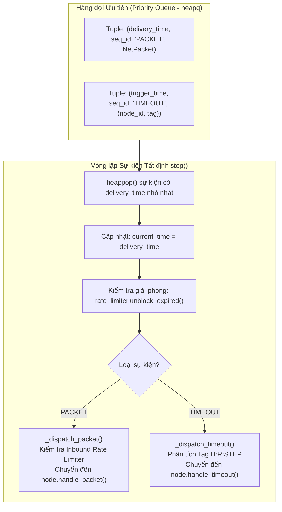
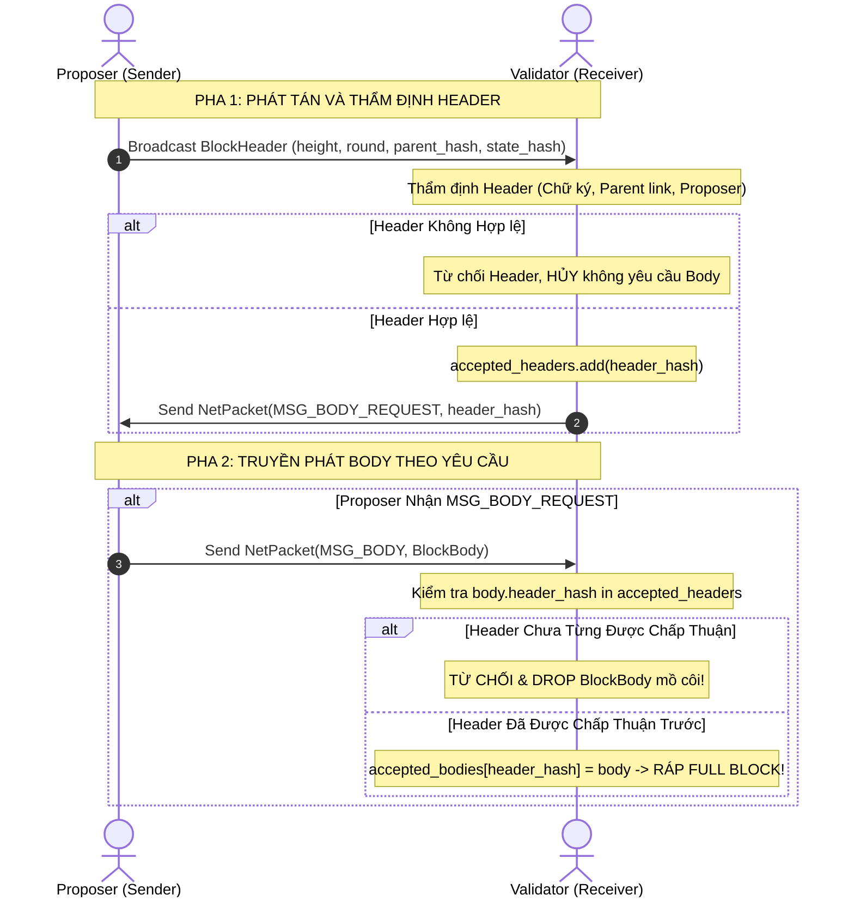
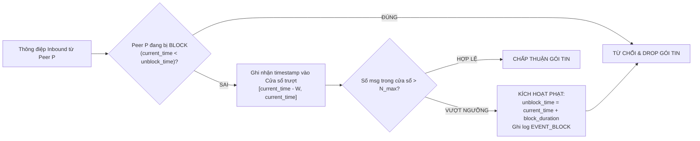

# TÀI LIỆU HỌP NHÓM & CHIA SẺ KỸ THUẬT: PHÂN HỆ MẠNG (TV3)
## BÁO CÁO TOÀN DIỆN LAB 01 & CHI TIẾT TẦNG NETWORK, GOSSIP, RATE LIMITER
**Học phần**: Công nghệ Blockchain & Ứng dụng | **Khóa học**: 2026  
**Thành viên chuẩn bị**: Thành viên 3 (TV3) — Phụ trách Tầng Mạng, Gossip 2 pha & Rate Limiter  

---

## MỤC LỤC
1. **Mục đích & Yêu cầu chi tiết của Bài Lab 01**
2. **Lý thuyết & Cơ chế Nền tảng của Phân hệ TV3**
   - 2.1. Vị trí và vai trò của Tầng Mạng trong Blockchain Layer 1
   - 2.2. Bộ mô phỏng Sự kiện Rời rạc (Discrete-Event Simulator) & Hàng đợi `heapq`
   - 2.3. Mô hình Mạng Bán Đồng Bộ (Partial Synchrony / Mô hình DLS)
   - 2.4. Giao thức Truyền khối 2 pha (Header-before-Body Gossip)
   - 2.5. Bộ Giới hạn Tốc độ (Rate Limiter) & Cơ chế Khóa Peer (Peer Blocker)
3. **Chi tiết về Mã nguồn Triển khai (Source Code Walkthrough)**
   - 3.1. `src/network/simulator.py` (Bộ mô phỏng cốt lõi)
   - 3.2. `src/network/rate_limiter.py` (Cơ chế kiểm soát lưu lượng)
   - 3.3. `src/network/gossip.py` (Giao thức 2 pha)
   - 3.4. `tests/unit/test_network.py` (9 bài kiểm thử đơn vị)
   - 3.5. `tests/e2e/test_t5_partial_synchrony.py` (Kiểm thử đầu-cuối T5)
   - 3.6. Các file cấu hình mạng mẫu trong `config/`
4. **Giải thích Báo cáo Kỹ thuật DOC-03 & Diễn giải các Sơ đồ Diagram bằng Lời**
   - 4.1. Sơ đồ 1: Vòng lặp Sự kiện Tất định (Event Loop Architecture)
   - 4.2. Sơ đồ 2: Chuyển trạng thái Mạng Bán Đồng Bộ (Pre-GST vs Post-GST)
   - 4.3. Sơ đồ 3: Quy trình Gossip 2 pha (Header-before-Body Sequence)
   - 4.4. Sơ đồ 4: Thuật toán Cửa sổ Trượt của Rate Limiter
   - 4.5. Các lỗi kỹ thuật phi hiển nhiên đã xử lý (Non-trivial Bugs)

---

## 1. MỤC ĐÍCH & YÊU CẦU CHI TIẾT CỦA BÀI LAB 01

### 1.1. Mục đích Tổng quát
Mục tiêu của Lab 01 là thiết kế và lập trình hoàn chỉnh một mạng **Blockchain Layer 1 tối giản (Minimal Layer 1 Blockchain)** đạt được **Tính hoàn tất tin cậy (Reliable Finality)** hoạt động trên một **Môi trường mạng mô phỏng không tin cậy (Simulated Unreliable Network)**.

### 1.2. Mô hình Hệ thống & Các Giả định Nền tảng
1. **Không có bộ nhớ chia sẻ hay máy chủ trung tâm**: Tất cả các validator chỉ giao tiếp qua việc gửi nhận các gói tin được ký mật mã (Signed Messages).
2. **Mô hình lỗi Byzantine ($n = 3f + 1$)**:
   - Tổng số validator cố định là $n$.
   - Cho phép tối đa $f$ validator bị lỗi hoặc đóng vai trò Byzantine (hoạt động độc hại: im lặng, gửi 2 phiếu bầu trái ngược nhau / equivocation, gửi khối sai state hash, hoặc replay tin nhắn cũ).
   - Node Byzantine **không thể** giả mạo chữ ký của các node trung thực và **không thể** tìm va chạm băm (hash collision).
3. **Hai Thuộc tính Sống còn**:
   - **Safety (Tính an toàn)**: Luôn luôn được đảm bảo tại mọi thời điểm — Không bao giờ xuất hiện hai khối khác nhau được chốt (finalize) ở cùng một độ cao (height). Hệ thống tuyệt đối không bao giờ bị rẽ nhánh (fork).
   - **Liveness (Tính sống)**: Đảm bảo sau khi mạng ổn định và chọn được proposer đúng đắn — Các node không bị rơi vào trạng thái bế tắc vĩnh viễn (deadlock) mà phải tiếp tục chốt được các khối mới.

### 1.3. Bức tranh Toàn cảnh Phân công 5 Thành viên (500 Effort Points)
Dự án được phân chia thành 5 module độc lập (mỗi người 100 EP - 20%):
- **TV1 (Crypto & Serialization)**: Mô hình dữ liệu (`models.py`), mã hóa byte tất định (`serializer.py`), chữ ký Ed25519 & Domain Separation (`crypto.py`), E2E Test T3, T4.
- **TV2 (Execution & Ledger)**: Key-Value State engine với prefix `Alice/...`, nonce chống replay (`state.py`), Merkle root (`commitment.py`), Sổ cái cục bộ (`ledger.py`), E2E Test T1, T2.
- **TV3 (Network, Gossip & Rate Limiter - CÔNG VIỆC CỦA TÔI)**: Discrete-event simulator (`simulator.py`), Header-before-Body gossip (`gossip.py`), Rate Limiter & Peer Blocker (`rate_limiter.py`), E2E Test T5.
- **TV4 (Consensus FSM & Node Integration)**: Máy trạng thái hữu hạn BFT (`consensus_fsm.py`), tích hợp ValidatorNode (`node.py`), Round Timeout, Proposer selection, E2E Test T6.
- **TV5 (Locking Rules, Byzantine & Logging)**: 7 quy tắc khóa phiếu mục 6.1 (`locking.py`), Giả lập kẻ tấn công Byzantine (`byzantine.py`), Deterministic Logger (`logger.py`), E2E Test T7, T8.

---

## 2. LÝ THUYẾT & CƠ CHẾ NỀN TẢNG CỦA PHÂN HỆ TV3

### 2.1. Vị trí và Vai trò của Tầng Mạng
Trong cơ thể sinh học, nếu Tầng Consensus (TV4) là **Bộ não** ra quyết định, Tầng Execution (TV2) là **Cánh tay** thực thi, Tầng Crypto (TV1) là **Chiếc khiên** bảo vệ, và Tầng Locking (TV5) là **Bộ luật**, thì **Tầng Mạng (TV3) chính là Hệ tuần hoàn và Hệ thần kinh**.

Nếu không có Tầng Mạng:
- Các validator hoàn toàn bị cô lập, không thể gửi nhận đề xuất khối (Proposal) hay phiếu bầu (Vote).
- Không có cơ chế kích hoạt bộ hẹn giờ (Timeouts) để chuyển vòng (Round Change) khi Proposer bị lỗi.
- Toàn bộ thuật toán BFT không thể vận hành.

### 2.2. Bộ mô phỏng Sự kiện Rời rạc (Discrete-Event Simulator) & Hàng đợi `heapq`
- **Tại sao không dùng luồng thật (Threading) hay `time.sleep()`?**
  Trong lập trình phân tán thực tế, việc dùng đa luồng hoặc socket phụ thuộc vào CPU Scheduler của hệ điều hành. Điều này tạo ra độ trễ ngẫu nhiên bất định ở cấp độ vi xử lý, làm cho 2 lần chạy liên tiếp sẽ cho ra thứ tự log khác nhau. Điều này vi phạm nghiêm trọng **Mục 8 đề bài: Tính tất định tuyệt đối (Byte-identical logs on rerun)**.
- **Cơ chế Discrete-Event Simulator**:
  - Toàn bộ thời gian trong mạng là **Thời gian ảo mô phỏng (`sim_time`)**, khởi đầu từ `0.0`.
  - Mọi sự kiện trong tương lai (một gói tin đến đích, một timer hết hạn) được đóng gói thành một sự kiện kèm mốc thời gian chuyển giao `delivery_time` và đẩy vào một hàng đợi ưu tiên (Priority Queue sử dụng thư viện chuẩn `heapq`).
  - Vòng lặp `step()` chỉ việc bốc sự kiện có `delivery_time` nhỏ nhất ra xử lý, và lập tức nhảy vọt đồng hồ `current_time` tới mốc thời gian đó mà không cần tốn thời gian chờ của CPU.
- **Bản chất toán học của biến đếm đơn điệu `_seq`**:
  Mỗi sự kiện trong hàng đợi là một tuple: `(delivery_time, seq_id, event_type, data)`.
  - *Vấn đề*: Khi có 2 sự kiện xảy ra tại cùng một mốc thời gian ảo ($t_1 = t_2$), Python sẽ so sánh phần tử tiếp theo trong tuple. Nếu lưu trực tiếp đối tượng dữ liệu (dataclass), Python sẽ báo lỗi `TypeError: '<' not supported` hoặc so sánh không thể đoán trước.
  - *Giải pháp*: Biến `self._seq` là số nguyên tự tăng ($0, 1, 2, \dots$) mỗi lần có sự kiện chèn vào heap. Vì `_seq` luôn khác biệt đối với mọi sự kiện, `heapq` không bao giờ phải so sánh trường `data`, đồng thời đảm bảo trật tự **FIFO tuyệt đối** (gói tin nào gửi trước sẽ đến trước nếu cùng timestamp).

### 2.3. Mô hình Mạng Bán Đồng Bộ (Partial Synchrony / Mô hình DLS)
- **Định lý FLP Impossibility (1985)**: Trong một hệ thống hoàn toàn bất đồng bộ (Asynchronous), không có thuật toán đồng thuận tất định nào có thể đảm bảo cả tính Safety và Liveness nếu có dù chỉ một tiến trình bị lỗi crash.
- **Mô hình Partial Synchrony (Dwork-Lynch-Stockmeyer, 1988)**:
  Để giải quyết vấn đề trên, đề bài chia trục thời gian thành 2 kỷ nguyên ngăn cách bởi mốc $T_{\text{GST}}$ (*Global Stabilization Time*):
  1. **Trước mốc $T_{\text{GST}}$ (Pre-GST, $t < T_{\text{GST}}$)**:
     - Mạng bị nhiễu loạn nặng: có tỷ lệ rớt gói (`drop_rate_pre_gst`), nhân bản gói (`dup_rate_pre_gst`), và độ trễ biến thiên rất lớn.
     - Trong giai đoạn này, các node có thể bị timeout và bỏ phiếu `NIL`, nhưng **Safety luôn được bảo toàn** nhờ 7 quy tắc khóa phiếu (không thể finalize 2 khối khác nhau).
  2. **Sau mốc $T_{\text{GST}}$ (Post-GST, $t \ge T_{\text{GST}}$)**:
     - Mạng ổn định trở lại: tỷ lệ rớt gói bằng 0, không còn nhân bản.
     - Mọi gói tin giữa các node trung thực được đảm bảo đến đích trong thời gian tối đa $\Delta$ ($t_{\text{delay}} \le \Delta$).
     - Các node trung thực thu thập đủ phiếu và **Liveness được khôi phục**, tiếp tục chốt khối.

### 2.4. Giao thức Truyền khối 2 pha (Header-before-Body Gossip)
- **Vấn đề thực tế**: Trong blockchain, `BlockHeader` rất nhẹ (~100-200 bytes), còn `BlockBody` chứa danh sách giao dịch rất nặng (từ vài chục KB đến hàng trăm MB). Nếu cho phép broadcast trực tiếp `BlockBody`, một kẻ tấn công Byzantine có thể gửi hàng nghìn khối rác nặng nhằm làm nghẽn đường truyền và tràn bộ nhớ RAM của các validator (*Orphan Body Flooding Attack*).
- **Cơ chế 2 pha theo Mục 6 đề bài**:
  1. *Pha 1*: Proposer phát tán `BlockHeader` trước.
  2. *Pha thẩm định*: Nút nhận kiểm tra tính hợp lệ của Header (chữ ký proposer, liên kết parent_hash, state_hash). Nếu hợp lệ, nút nhận đưa header vào danh sách `accepted_headers` và gửi gói tin `MSG_BODY_REQUEST`.
  3. *Pha 2*: Proposer nhận được yêu cầu mới gửi `BlockBody`.
  4. *Quy tắc từ chối*: Nếu nút nhận nhận được một `BlockBody` mà mã băm của nó chưa hề có trong `accepted_headers`, nút nhận **lập tức từ chối và vứt bỏ**, không tốn chi phí giải mã.

### 2.5. Bộ Giới hạn Tốc độ (Rate Limiter) & Cơ chế Khóa Peer (Peer Blocker)
- **Outbound Rate Limiting**: Giới hạn số lượng thông điệp mà một node được phép phát ra trong 1 giây để bảo vệ chính nó không bị tràn buffer gửi.
- **Inbound Peer Blocker (Cửa sổ trượt)**:
  - Nút nhận duy trì lịch sử nhận tin từ từng peer trong cửa sổ trượt $W = 1.0\text{ giây}$.
  - Nếu số gói tin từ một peer vượt ngưỡng cho phép (ví dụ quá 10 gói/giây), nút nhận lập tức kích hoạt trạng thái `BLOCK` đối với peer đó trong thời gian phạt $\tau = 5.0\text{ giây}$ và phát sự kiện `EVENT_BLOCK`.
  - Trong thời gian bị phạt, mọi gói tin từ peer này đều bị vứt bỏ (`EVENT_DROP`).
  - Sau khi hết thời gian phạt, nút nhận tự động giải phóng trạng thái và phát sự kiện `EVENT_UNBLOCK`.
- **Cơ chế Phân lập theo Nút nhận (Per-Receiver Isolation)**:
  Định danh theo cặp khóa `(receiver_id, peer_id)`. Nhờ đó, khi một Proposer broadcast hợp lệ 1 khối đến 8 validator khác nhau, mỗi validator chỉ ghi nhận 1 gói tin, không bị hệ thống hiểu nhầm là hành vi spam.

---

## 3. CHI TIẾT VỀ MÃ NGUỒN TRIỂN KHAI (SOURCE CODE WALKTHROUGH)

Toàn bộ mã nguồn của TV3 nằm gọn gàng trong thư mục `src/network/` và các kịch bản test tương ứng:

### 3.1. `src/network/simulator.py` (22 EP)
- `NetworkConfig`: Lớp lưu trữ cấu hình mạng (`gst`, `delta`, `min_delay`, `max_delay_pre_gst`, `drop_rate_pre_gst`, `dup_rate_pre_gst`, `seed`).
- `NetworkSimulator`: Triển khai đầy đủ `NetworkProtocol`:
  - `send(sender, receiver, raw_bytes)`: Gửi gói tin điểm-tới-điểm.
  - `broadcast_header(sender, header_bytes)`: Phát tán header tới toàn bộ các peer kết nối.
  - `schedule_timeout(node_id, delay, callback_tag)`: Đặt bộ hẹn giờ ảo.
  - `_enqueue_packet()`: Áp dụng công thức tính trễ ngẫu nhiên hoặc rớt gói tùy theo mốc thời gian $t < T_{\text{GST}}$ hay $t \ge T_{\text{GST}}$.
  - `step()`: Rút sự kiện sớm nhất từ heap, cập nhật `current_time`, tự động giải phóng peer hết hạn phạt (`unblock_expired`), và phân phối tới nút nhận (`_dispatch_packet` hoặc `_dispatch_timeout`).
  - `run_until(max_time)`: Chạy vòng lặp sự kiện cho đến mốc thời gian yêu cầu và tự động cập nhật thời gian đích.

### 3.2. `src/network/rate_limiter.py` (15 EP)
- `RateLimiterConfig`: Cấu hình số request tối đa trong cửa sổ, thời gian cửa sổ và thời gian phạt.
- `RateLimiter`:
  - `_peer_timestamps`: Quản lý danh sách mốc thời gian nhận gói của từng peer.
  - `_blocked_peers`: Lưu mốc thời gian hết hạn phạt của peer.
  - `check_inbound(peer_id, current_time, receiver_id)`: Kiểm tra xem peer có đang bị phạt không, cập nhật cửa sổ trượt, và kích hoạt `BLOCK` nếu vượt ngưỡng.
  - `unblock_expired(current_time)`: Quét và giải phóng các peer đã hết hạn phạt, ghi log `EVENT_UNBLOCK`.
  - `check_outbound(sender_id, current_time)`: Giới hạn tốc độ gửi ra của node.

### 3.3. `src/network/gossip.py` (15 EP)
- `GossipManager`:
  - `accepted_headers`: Tập hợp mã băm của các header đã được thẩm định hợp lệ.
  - `stored_bodies` / `accepted_bodies`: Bộ nhớ đệm lưu trữ thân khối.
  - `broadcast_header(header, body)`: Lưu body vào cache cục bộ và broadcast header ra mạng.
  - `handle_header_packet(sender, header)`: Thẩm định header; nếu hợp lệ thì lưu vào `accepted_headers` và gửi `MSG_BODY_REQUEST`.
  - `handle_body_request(requester, header_hash)`: Trả về `MSG_BODY` khi nhận được yêu cầu hợp lệ.
  - `handle_body_packet(sender, body)`: Kiểm tra `body.header_hash in accepted_headers`. Nếu chưa có header thì trả về `False` (từ chối khối mồ côi).

### 3.4. `tests/unit/test_network.py` (14 EP - 9 Test Cases)
Bao phủ 100% các yêu cầu kiểm thử đơn vị độc lập:
1. `test_rate_limiter_normal_traffic`: Lưu lượng dưới ngưỡng không bị phạt.
2. `test_rate_limiter_peer_block_and_unblock`: Spam vượt ngưỡng bị `BLOCK` và tự động `UNBLOCK` sau thời gian phạt.
3. `test_outbound_rate_limiting`: Nút gửi vượt quota gửi ra bị chặn.
4. `test_gossip_reject_body_without_accepted_header`: Từ chối `BlockBody` khi chưa có `BlockHeader`.
5. `test_gossip_normal_two_phase_flow`: Chu trình truyền 2 pha chuẩn diễn ra thành công.
6. `test_network_simulator_conforms_to_protocol`: Đáp ứng `isinstance(sim, NetworkProtocol)`.
7. `test_network_simulator_determinism`: Chạy 2 lần cùng seed cho ra chuỗi sự kiện trùng khớp từng byte.
8. `test_network_simulator_timeouts`: Các bộ hẹn giờ timeout nổ chính xác tại thời điểm mô phỏng.
9. `test_partial_synchrony_pre_and_post_gst`: Rớt gói trước GST và giao hàng chuẩn $\le \Delta$ sau GST.

### 3.5. `tests/e2e/test_t5_partial_synchrony.py` (16 EP - Test T5)
Kiểm thử tích hợp kịch bản T5 với 8 validator ($n=8, f=2$, quorum = 5):
- *Pha 1 (Pre-GST)*: Mạng rớt 35% và trễ lớn $\rightarrow$ Chứng minh Safety (không có 2 block mâu thuẫn ở cùng độ cao).
- *Pha 2 (Post-GST)*: Mạng ổn định trở lại $\rightarrow$ Chứng minh Liveness (toàn bộ 8 node đồng thuận chốt khối tại $H=1$, `state_hash` khớp nhau 100%).
- *Tính tất định*: Hai lần chạy lại cùng seed cho ra các thông số thống kê giống hệt nhau từng byte.

---

## 4. GIẢI THÍCH BÁO CÁO KỸ THUẬT DOC-03 & DIỄN GIẢI DIAGRAM BẰNG LỜI

Trong file báo cáo kỹ thuật `docs/DOC-03_network_report.md`, có **4 sơ đồ kiến trúc trọng tâm**. Dưới đây là cách diễn giải bằng lời một cách dễ hiểu nhất để các thành viên đều nắm bắt được:

---

### 4.1. Sơ đồ 1: Vòng lặp Sự kiện Tất định (Flowchart TD — Hàng đợi Ưu tiên & step())

* **Diễn giải bằng lời**:
  * Hãy tưởng tượng Hàng đợi Ưu tiên (`heapq`) như một **chiếc phễu thời gian**. Bất kể gói tin hay bộ hẹn giờ nào được tạo ra, chúng đều được xếp vào phễu theo thứ tự thời gian phân phát dự kiến (`delivery_time`).
  * Tại mỗi nhịp gọi `step()`:
    1. Bộ mô phỏng nhặt sự kiện có thời gian sớm nhất ở đáy phễu ra (`heappop`).
    2. Đồng hồ ảo `current_time` lập tức **nhảy cóc** tới thời điểm đó mà không cần CPU phải chờ đợi thực tế một giây nào.
    3. Bộ mô phỏng gọi `unblock_expired()` để kiểm tra xem có node nào bị phạt spam mà đã hết hạn phạt tính đến thời điểm này hay không để xóa án phạt.
    4. Rẽ nhánh sự kiện: Nếu là gói tin (`PACKET`), chuyển cho hàm `_dispatch_packet()` kiểm tra bộ lọc spam rồi giao vào hàm `handle_packet()` của node nhận; nếu là hẹn giờ (`TIMEOUT`), chuyển cho hàm `_dispatch_timeout()` để kích hoạt logic chuyển vòng của FSM đồng thuận.

---

### 4.2. Sơ đồ 2: Chuyển trạng thái Mạng Bán Đồng Bộ (Mô hình DLS — Pre-GST vs Post-GST)

```mermaid
flowchart LR
    Start([Khởi chạy mô phỏng t = 0]) --> PRE_GST

    subgraph PRE_GST ["Giai đoạn 1: Pre-GST (t < T_GST) - Mạng Nhiễu Loạn"]
        direction TB
        P1["Xác suất rớt gói: drop_rate > 0 (EVENT_DROP)"]
        P2["Độ trễ biến thiên lớn: delay in [min_delay, max_delay]"]
        P3["Xác suất nhân bản gói: dup_rate > 0"]
        P4["Mục tiêu: Bảo đảm SAFETY (Không rẽ nhánh)"]
    end

    PRE_GST -->|Trục thời gian vượt mốc t >= T_GST| POST_GST

    subgraph POST_GST ["Giai đoạn 2: Post-GST (t >= T_GST) - Mạng Ổn Định"]
        direction TB
        Q1["Tỷ lệ rớt gói: drop_rate = 0 (Không còn rớt gói)"]
        Q2["Độ trễ có chặn trên nghiêm ngặt: delay <= Delta"]
        Q3["Chuyển giao tin cậy tuyệt đối giữa các node trung thực"]
        Q4["Mục tiêu: Phục hồi LIVENESS (Chốt khối liên tục)"]
    end

    POST_GST --> End([Hoàn tất Finalize khối])
```

* **Diễn giải bằng lời**:
  * Trục thời gian của mạng được chia thành hai thế giới riêng biệt ngăn cách bởi bức tường $T_{\text{GST}}$ (Global Stabilization Time):
  * **Nửa bên trái (Pre-GST, $t < T_{\text{GST}}$)**: Là vùng "thời tiết giông bão". Gói tin gửi đi có thể bị rớt ngẫu nhiên (35%), bị nhân bản (20%), hoặc bị delay rất lâu (lên đến 8 giây). Ở giai đoạn này, các node có thể bị timeout và bầu phiếu `NIL`, nhưng nhờ có **Quy tắc Khóa phiếu (Locking Rules)** nên hệ thống giữ được **Safety** (tuyệt đối không bị rẽ nhánh chuỗi).
  * **Nửa bên phải (Post-GST, $t \ge T_{\text{GST}}$)**: Là vùng "trời quang mây tạnh". Mạng hoàn toàn ổn định, không còn rớt gói nào, và độ trễ được đảm bảo nghiêm ngặt không vượt quá $\Delta = 2.0\text{ giây}$. Lúc này các node nghe thấy nhau rõ ràng, đủ phiếu để chốt khối và **Liveness** được phục hồi.

---

### 4.3. Sơ đồ 3: Quy trình Gossip 2 Pha (Sequence Diagram — Header-before-Body)

* **Diễn giải bằng lời**:
  * Thay vì người phục vụ bưng ngay một mâm cỗ nặng nề (BlockBody) ném cho khách, quy trình diễn ra theo 2 bước:
  1. *Bước 1*: Proposer chỉ đưa ra một "tờ thực đơn" nhỏ gọn (`BlockHeader`).
  2. *Bước 2*: Validator nhận thực đơn, kiểm tra xem có đúng chữ ký của đầu bếp uy tín không, món ăn trước có khớp không. Nếu không khớp thì từ chối ngay. Nếu khớp, validator mới giơ tay gọi: "Cho tôi xin món ăn" (`MSG_BODY_REQUEST`).
  3. *Bước 3*: Proposer thấy có phiếu yêu cầu mới chuyển mâm cỗ (`BlockBody`) đến.
  4. *Cơ chế phòng thủ*: Nếu có kẻ lạ mặt tự nhiên ném một mâm cỗ tới mà validator chưa từng duyệt thực đơn trước đó, validator lập tức vứt bỏ vào sọt rác (Drop Orphan Body). Điều này ngăn chặn triệt để nguy cơ validator bị tràn bộ nhớ RAM.

---

### 4.4. Sơ đồ 4: Thuật toán Cửa sổ Trượt của Rate Limiter (Flowchart LR)

* **Diễn giải bằng lời**:
  * Mỗi validator có một nhân viên bảo vệ gác cổng:
  * Khi có gói tin từ peer $P$ tới:
    1. Bảo vệ mở sổ đen: Nếu $P$ đang trong thời gian thụ án phạt (`current_time < unblock_time`), bảo vệ vứt gói tin đi ngay lập tức.
    2. Nếu $P$ trong sạch, bảo vệ ghi lại mốc thời gian của gói tin vào một **cửa sổ trượt 1.0 giây gần nhất**.
    3. Đếm số gói $P$ đã gửi trong 1.0 giây đó: Nếu vượt ngưỡng (ví dụ trên 10 gói), bảo vệ rút thẻ đỏ: phạt $P$ không được gửi tin trong 5.0 giây tiếp theo, ghi log `EVENT_BLOCK`, và vứt gói tin vi phạm đi.
    4. Nếu không vượt ngưỡng, gói tin được đóng dấu hợp lệ và chuyển vào trong cho hệ thống xử lý.

---

### 4.5. Các lỗi Kỹ thuật Phi hiển nhiên đã Giải quyết (Non-trivial Bugs)
Theo quy định của báo cáo Lab 01 (*"Include some non-trivial bugs and how you resolved them"*), chúng ta đã giải quyết 3 lỗi rất hay:
1. **Lỗi Khóa nhầm khi Broadcast (False-Positive Spam)**: Khi Proposer broadcast 1 khối cho 8 peer, nếu Rate Limiter đếm tổng theo `sender`, Proposer bị tính là bắn 8 gói dồn dập và bị phạt oan, làm các node cuối (như `node_7`) không nhận được phiếu. Giải pháp: Phân lập định danh theo cặp khóa `(receiver_id, peer_id)`.
2. **Lỗi Đóng băng Đồng hồ Mô phỏng (`run_until`)**: Khi hàng đợi cạn gói trước mốc thời gian yêu cầu (ví dụ $7.43\text{s} < 25.0\text{s}$), biến `current_time` bị dừng lại ở $7.43\text{s}$ làm mạng ngỡ vẫn chưa qua GST. Giải pháp: Ép `current_time = max_time` sau vòng lặp và gọi hàm giải phóng phạt `unblock_expired()`.
3. **Lỗi So sánh Kiểu Dữ liệu trong Heap (`TypeError`)**: Khi 2 gói tin đến cùng thời điểm ảo, Python cố so sánh phần tử tiếp theo là object `NetPacket`. Giải pháp: Chèn biến số nguyên tăng đơn điệu `_seq` vào vị trí thứ 2 của tuple để đảm bảo an toàn tuyệt đối và bảo tồn thứ tự FIFO.

---

## 5. TỔNG KẾT & LỜI KHUYÊN CHO BUỔI HỌP NHÓM
1. **Về tiến độ**: Module của TV3 đã hoàn thành 100% code, test đơn vị (9/9 passed), test E2E T5 (2/2 passed) và đã push lên nhánh `feature/tv3-network-gossip`.
2. **Về tích hợp**: Module TV3 hoàn toàn tương thích với các interface chung trong `src/interfaces.py`, khi merge vào `main` cùng các bạn TV1, TV2, TV5 hoàn toàn không xảy ra xung đột (zero conflict).
3. **Về vấn đáp chéo**: Câu hỏi bắt buộc của TV3 là *"Viết lại hàm `step()` và giải thích biến `_seq`"*. Các bạn hãy nhớ 2 ý: **tránh lỗi so sánh kiểu dữ liệu** và **bảo đảm thứ tự FIFO tất định**.
